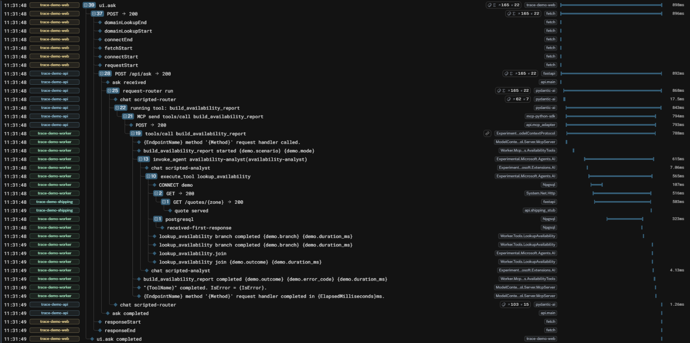
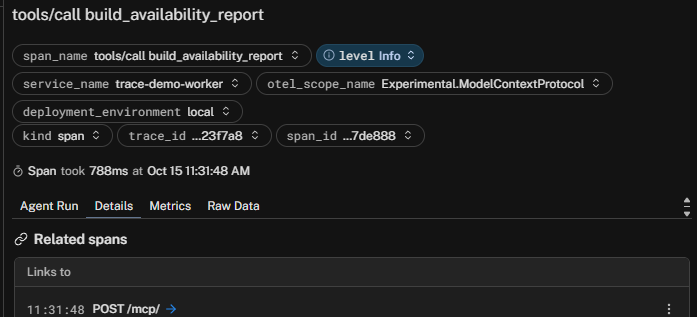
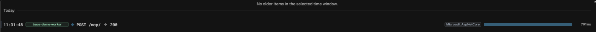
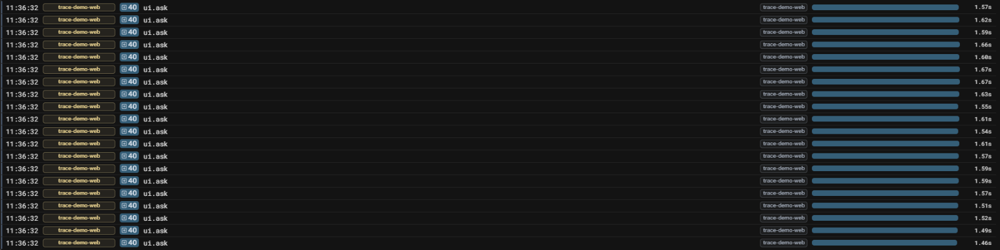
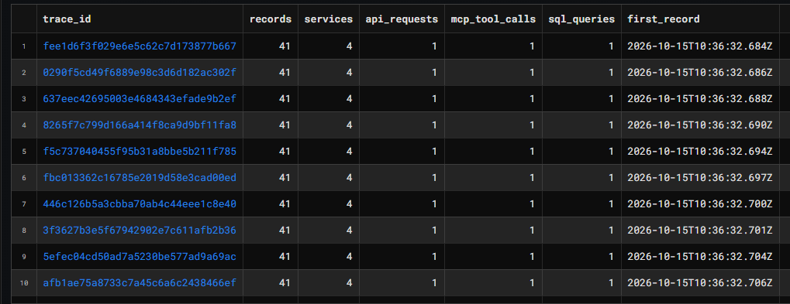
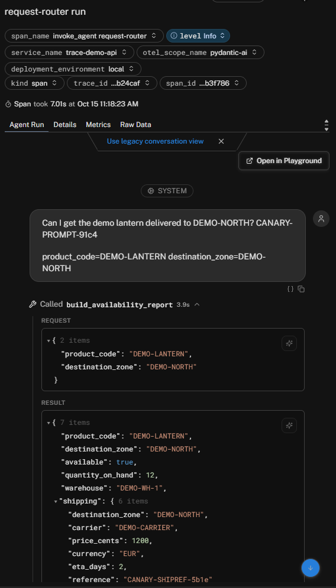
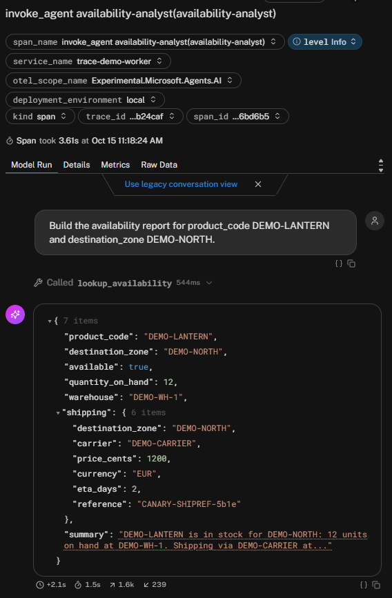
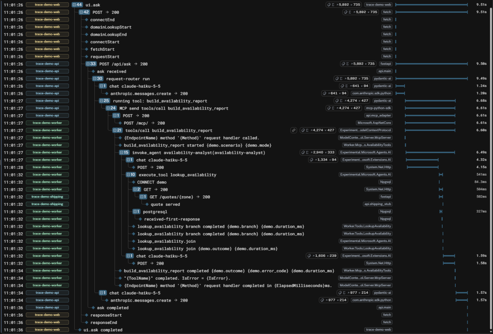

# One Click, Two Agents, Three Runtimes: Can OpenTelemetry Keep the Thread?

*Draft. Every number below comes from raw OTLP evidence captured by the repository's Collector on the pinned stack
in [docs/compatibility.md](../compatibility.md). Logfire screenshots come from the one live run and are cropped to
exclude account details and MCP session ids.*

## 1. The wager

One browser button. Behind it: a React app, a FastAPI service running a Pydantic AI agent, an MCP call over
Streamable HTTP to an ASP.NET Core server, a Microsoft Agent Framework agent there, and a local tool that queries
PostgreSQL and calls an HTTP service **at the same time**. Three runtimes, two agent frameworks, two MCP SDKs.

"Continuity" means something strict here: every span of that one click shares the browser's trace id, every
non-root span's parent exists in the captured trace, the parents are the *right* ones, and the two I/O calls
measurably overlap under the tool that launched them. A shared backend, matching service names or a common
request id do not count — the Collector forwards; it does not repair parents.

## 2. The first waterfall

The deterministic mode swaps each framework's model for a scripted one at its model abstraction (a Pydantic AI
`FunctionModel`, an `IChatClient` for MAF). The agent loops, MCP transport, SQL and HTTP are all real. One
Playwright-driven click produced 19 spans across four services:

```text
web    ui.ask                                          811 ms
web    └ POST                                          810 ms   fetch instrumentation
api      └ POST /api/ask                               805 ms   FastAPI
api        └ invoke_agent request-router               781 ms   Pydantic AI
api          ├ chat scripted-router                     15 ms
api          ├ execute_tool build_availability_report  761 ms
api          │ └ MCP send tools/call build_avail…      709 ms   mcp SDK  — params._meta
api          │   ├ POST                                709 ms   httpx2 hook — traceparent header
worker       │   │ └ POST /mcp/                        705 ms   ASP.NET Core
worker       │   └ tools/call build_availability_report 701 ms  MCP C# SDK (link → POST /mcp/)
worker       │     └ invoke_agent availability-analyst 582 ms   MAF
worker       │       ├ chat scripted-analyst             5 ms
worker       │       ├ execute_tool lookup_availability 546 ms
worker       │       │ ├ postgresql                    321 ms   Npgsql   ┐ 321 ms overlap
worker       │       │ └ GET                           510 ms   HttpClient┘
shipping     │       │   └ GET /quotes/{zone}          502 ms
worker       │       └ chat scripted-analyst             3 ms
api          └ chat scripted-router                      1 ms
```

The assertion tool (`scripts/assert-traces.py`) checks sixteen relationships on that graph and passes. Twenty
simultaneous clicks over the API's single long-lived MCP client produced twenty distinct traces, each with exactly
one API request and one MCP operation, and zero spans parented into another submission's trace (section 6).

## 3. The boundary ledger

| Hop | Who creates the span | Who injects | Carrier | Who extracts |
|---|---|---|---|---|
| click → fetch | app (`ui.ask`) | fetch instrumentation | `traceparent` header | FastAPI instrumentation |
| agent → MCP message | `mcp` SDK (`MCP send …`) | `mcp` SDK | `params._meta.traceparent` | MCP C# SDK |
| MCP → HTTP | **our ~100-line httpx2 hook** | the hook | `traceparent` header | ASP.NET Core |
| tool → SQL ∥ HTTP | Npgsql, HttpClient | — | `ExecutionContext` | — |
| .NET → stub | HttpClient | HttpClient instrumentation | header | FastAPI |

The surprise in the middle row: the MCP Python stack now runs on **httpx2**, and there is no OpenTelemetry
instrumentor for it. Out of the box, nothing creates the Python HTTP client span and nothing puts a `traceparent`
header on `POST /mcp`. Installing the familiar `opentelemetry-instrumentation-httpx` would have done nothing at
all — it patches a library the MCP client no longer uses. We closed the gap with one transport wrapper with a
written removal condition ([ADR 0001](../decisions/0001-httpx2-transport-hook.md)).

## 4. The MCP surprise: two carriers, two parents

The MCP message and its HTTP request carry **the same trace id with different parent span ids**. The `_meta`
carrier names the logical `MCP send` span; the header names the HTTP client span nested under it. The C# SDK
parents its `tools/call` server span to the message carrier and *links* it to the ASP.NET request span. So in the
waterfall the .NET MCP operation is a sibling of the HTTP request, not its grandchild. That is the intended
"message-first" graph, and it is why the checks test relationships, not indentation.

Removing one carrier at a time shows they are independent:

- **Headers removed:** the ASP.NET span roots a brand-new trace, yet the MCP operation and everything below it
  stays in the browser's trace via `_meta` — and its link now points *across* traces.
- **`_meta` removed:** the trace id survives end to end via the header, but the MCP operation's parent silently
  becomes the ASP.NET span. Nothing looks broken in a waterfall; only the parent-id check notices.
- **Both removed:** every .NET span lands in one separate trace.

Here is the headers-removed break as Logfire shows it (scripted run, so no model spend). At first glance the trace
looks complete: every logical span is there, the .NET agent, the tool, SQL and HTTP all nest under the Python MCP
call. The only visible damage is that the Python transport span `POST → 200` is now a **leaf**; in the baseline it
had the .NET `POST /mcp/` under it. 18 spans instead of 19.



The .NET `tools/call` row still carries a link icon, and its *Related spans* panel looks exactly as it does in the
baseline:



Only following the link shows the split: it opens a different trace containing a single root span — the ASP.NET
request, 791 ms, nothing above it and nothing below it. Its user agent (`python-httpx2/2.13.1`) is the only
remaining hint of where it came from.



That is the argument for asserting on parent ids rather than eyeballing waterfalls: a lost transport carrier
removes one row from a 19-row tree and adds a one-span trace somewhere else in the project.

Both SDKs also behaved well with hostile input: garbage, truncated, all-zero and version-`ff` `_meta` values were
discarded (the operation fell back to its HTTP parent), an all-zero header produced a fresh root, and conflicting
header/`_meta` trace ids were never merged — each SDK honoured its own carrier, joined only by the link.

## 5. Two branches at once

`lookup_availability` starts the SQL query and the HTTP quote while its span is current, then awaits
`Task.WhenAll`. The fixture delay lives *inside* each operation (a `pg_sleep` in a materialized CTE; a sleeping
stub), so the leaf spans show real work.

| Variant | SQL span | HTTP span | Overlap | Tool span |
|---|---|---|---|---|
| parallel (baseline) | 321 ms | 510 ms | **321 ms** | 546 ms (≈ max) |
| serial (`await` SQL first) | 320 ms | 512 ms | **−3.7 ms** | 943 ms (≈ sum) |

Both spans come from the same .NET clock, so the overlap is a safe hard assertion; the cross-host comparisons in
this project use ids only.

The one way we found to *lose* a branch was to create it without the ambient `ExecutionContext`
(`SuppressFlow()` + a yield): the HTTP client span and the stub's server span moved to a new trace while the SQL
branch stayed put. `ConfigureAwait(false)` alone does no such thing.

## 6. Twenty clicks at once

One click producing one trace proves little if two clicks at the same moment can tangle. Everything below the
browser is shared: one FastAPI process, one long-lived Pydantic AI MCP client with one httpx2 client and transport
hook, one .NET worker with one Npgsql connection pool and one `HttpClient`. If any of them kept trace context in
shared state — a `traceparent` stored on the client's default headers at startup is the classic mistake — later
requests would become children of an earlier one.

So Playwright opens twenty separate browser contexts, fills in all twenty forms, and submits them together. The
burst was real concurrency, not a queue: measured from the spans, **all twenty requests were in flight at the
same moment** at the FastAPI server, at the .NET MCP server, and inside the local tool. Their first records
landed within 118 ms of each other, and the whole burst finished in 1.6 s (median request 1.5 s against roughly
0.9 s for a lone click — the contention is visible, the bleeding is not).

In Logfire that is twenty `ui.ask` roots side by side, each a separate trace with the same 40 descendants:



Logfire's SQL Workbench gives the same answer per trace:

```sql
SELECT trace_id,
       count(*)                     AS records,
       count(DISTINCT service_name) AS services,
       sum(CASE WHEN span_name = 'POST /api/ask' THEN 1 ELSE 0 END)                        AS api_requests,
       sum(CASE WHEN span_name = 'tools/call build_availability_report' THEN 1 ELSE 0 END) AS mcp_tool_calls,
       sum(CASE WHEN span_name = 'postgresql' THEN 1 ELSE 0 END)                           AS sql_queries,
       min(start_timestamp)         AS first_record
FROM records
WHERE start_timestamp BETWEEN '2026-10-15T10:36:30Z' AND '2026-10-15T10:36:40Z'
GROUP BY trace_id
ORDER BY first_record
```



Twenty rows, all identical: 41 records (19 spans, 12 log records, 10 span events), 4 services, exactly one API
request, one MCP tool call and one SQL query. A bleed would show up here as a trace with two MCP calls and
another with none.

The authoritative check runs on the raw Collector file rather than a UI. `assert-traces.py` ran all sixteen
per-trace checks on each of the twenty traces — 320 passes — plus three cross-run checks: twenty distinct trace
ids, **zero spans parented into another submission's trace**, and exactly one API request and one MCP operation
per trace. Nothing here needed special handling. Every carrier is built per request from the span that is current
at that moment: the httpx2 hook builds a fresh header carrier for each request, the mcp SDK injects `_meta`
per message, and .NET flows `ExecutionContext` per request. The long-lived client only carries connections.

## 7. Break it on purpose

Eight break/repair pairs ran on the same stack, each changing one variable, each with an expected failing check,
a minimal repair and a passing rerun ([experiments/](../../experiments/README.md)). Three are worth separating:

- **Missing propagation** (`both-removed`, `context-detached`): spans exist, but in *another* trace. The tool
  reports exactly which categories moved and to which trace.
- **Lost export** (`export-failure`, only the API pointed at a dead endpoint): the .NET spans still carry the
  browser's trace id but their parents never arrive. "Dangling parent with the right trace id" is the signature
  of export loss, and the tool says so.
- **Logical failure over HTTP 200** (`logical-error`): the HTTP span is a clean 200, the Python `MCP send` span
  stays UNSET (the JSON-RPC exchange succeeded), while Python's `execute_tool` and the .NET MCP operation are
  ERROR with `error.type=tool_error`. If your dashboard only colours HTTP errors, this request looks healthy.

## 8. Same trace, different vocabulary

The two agent frameworks agree on `invoke_agent`, `chat` and `execute_tool`, and on little else: Pydantic AI's
agent span is INTERNAL, MAF's is CLIENT; Pydantic AI's scripted model reports *estimated* token usage (we tag
those spans `demo.model.synthetic=true`), M.E.AI's reports none; FastAPI's instrumentation still emits the old
HTTP attribute names while ASP.NET Core emits the stable ones; Npgsql 10 already uses `db.query.text`. We kept
the raw attributes and wrote a comparison table instead of normalising evidence
([compatibility.md](../compatibility.md#observed-python-vs-net-differences-same-trace-different-vocabulary)).

Content capture is off in both frameworks by default. Turning it on leaked four of our five canaries — prompt,
completion, the .NET agent's summary, and a shipping reference that only ever travels inside tool results — into
span attributes. The header canary never appeared in either setting.

With capture on, Logfire turns the same attributes into readable conversations — and shows the vocabulary gap
again: the Python agent span opens as an *Agent Run*, the .NET agent span (a CLIENT span with model attributes)
as a *Model Run*:

| Python `request-router` | .NET `availability-analyst` |
|---|---|
|  |  |

No telemetry content crosses the MCP boundary: the tracing part of `_meta` is just `traceparent`. The two
conversations are joined by trace ids, not by copying captured content between runtimes.

## 9. Results and limits

Continuity held across every boundary — but one boundary only after we wrote the instrumentation the ecosystem
does not yet ship. With real Anthropic models (`claude-haiku-5-5` in both agents) the same contract passed: one
trace of 23 spans, ≈9.5 s end to end, four model calls (≈4.6k input / 0.6k output tokens), and the Collector
fanned out to Logfire without export errors. Live mode also exposed two things scripted mode cannot: the
Anthropic Python SDK now traces itself by default, adding a second model span under Pydantic AI's, and MAF reports
the agent's *aggregate* usage under the same `gen_ai.usage.*` keys as its model spans — sum every span and you
double-count.

In Logfire the live run is one waterfall across all four services, with the .NET MCP span's link to its HTTP
request listed under *Related spans*, and both agents picked up on the Agents page:



Three things the UI adds that raw OTLP does not show: Pydantic AI spans are displayed under friendlier names
(`request-router run`, `running tool: …`) while .NET spans keep their OTLP names; the root's token badge reads
5,892 in / 735 out for model calls that total 4,558 / 641 — the MAF usage-key collision, now on screen; and .NET
log lines appear as unformatted message templates. The SQL/HTTP overlap is real in Logfire's stored timestamps
(326.6 ms, identical to the Collector file) but too small to see at the scale of a 9.5-second trace.

What we did not verify: cross-origin CORS behaviour, sampling, and clock skew beyond "never compare timestamps
across hosts". Browser export is best effort: the fetch
instrumentation ends its span about 300 ms after the response, so flushing right after rendering silently drops
it — the app waits for open spans before flushing. In the browser, ambient context did **not** survive a single
`await` in any run; the app re-enters context explicitly.

## 10. Reproduce it

```bash
./scripts/demo.sh up --mode scripted
./scripts/demo.sh run --scenario baseline && ./scripts/demo.sh verify
./scripts/demo.sh run --scenario concurrency && ./scripts/demo.sh verify --manifest evidence/runs/latest-concurrency.json
./scripts/demo.sh experiment all && ./scripts/demo.sh probe-carriers
```

Pinned versions, lockfile hashes and every observed behaviour: [docs/compatibility.md](../compatibility.md).

| Hypothesis | Observation | Explanation | Fix |
|---|---|---|---|
| MCP keeps the trace across Python → .NET | yes for the message, **no HTTP header** | MCP client moved to httpx2; no instrumentor exists | one transport hook (ADR 0001) |
| One carrier is enough | `_meta`-only keeps the logical chain; header-only keeps the trace but re-parents | message-first SDK design, HTTP fallback | keep both |
| `await` keeps browser context | never (0/37 recorded runs) | zone.js cannot patch native async/await | start fetch synchronously, re-enter explicitly |
| `Task.WhenAll` branches stay parented | yes, unless flow is suppressed | `ExecutionContext` flows into tasks | none needed |
| Shared MCP client is safe under load | 20/20 isolated | per-request carriers, no default headers | none needed |
