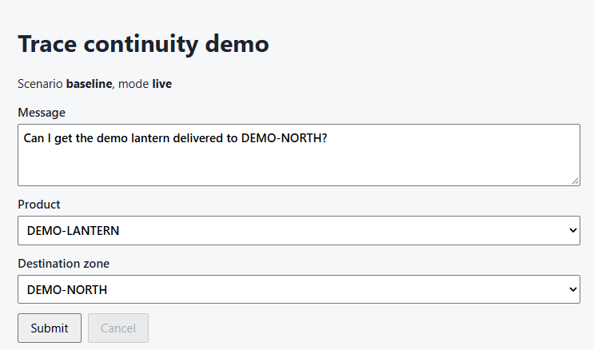
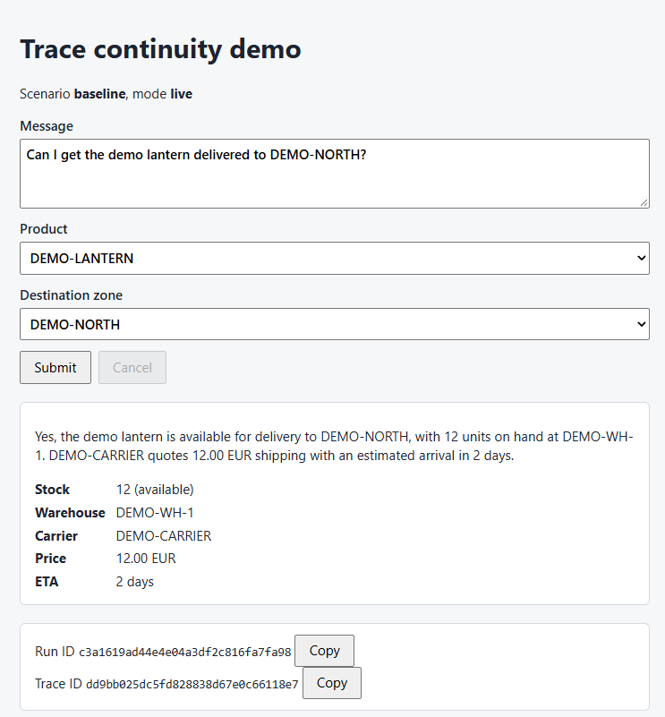
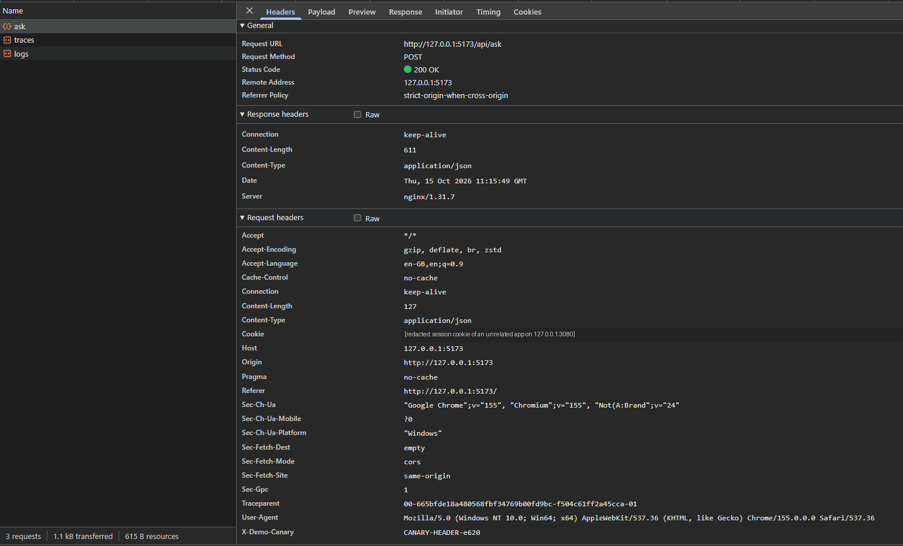
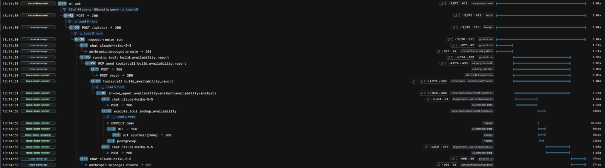
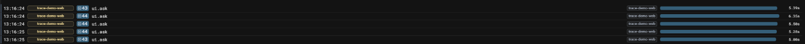
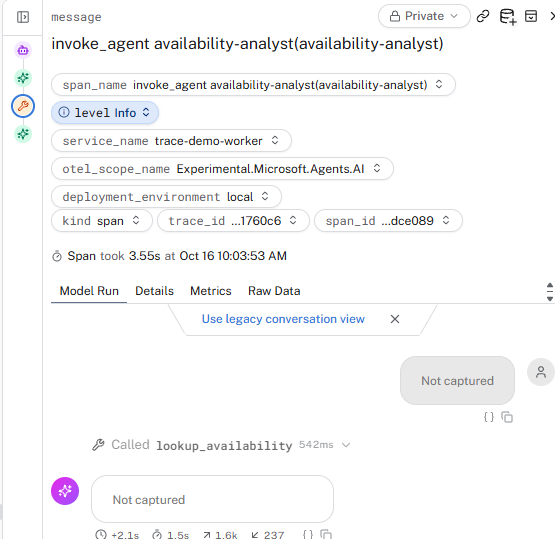

# One Click, Two Agents, Three Runtimes: Can OpenTelemetry Keep the Thread?

*Draft. The running example is a real click: a person-style click in Chrome on the demo page, with live Anthropic
models (`claude-haiku-5-5`) in both agents, exported through one Collector to Logfire. Every number comes from the
raw OTLP evidence the Collector wrote for that click, checked by the repository's assertion tool. Two things are
deliberately automated and labelled as such: the break/repair laboratory (section 7) and the 20-way stress test
(end of section 6). They use the same stack with scripted models, so they are deterministic and free to repeat.
Screenshots are cropped to exclude account details and MCP session ids. Pinned versions are in
[docs/compatibility.md](../compatibility.md).*

## 1. The wager

One browser button. Behind it: a React app, a FastAPI service running a Pydantic AI agent, an MCP call over
Streamable HTTP to an ASP.NET Core server, a Microsoft Agent Framework agent there, and a local tool that queries
PostgreSQL and calls an HTTP service **at the same time**. Three runtimes, two agent frameworks, two MCP SDKs.

"Continuity" means something strict here: every span of that one click shares the browser's trace id, every
non-root span's parent exists in the captured trace, the parents are the *right* ones, and the two I/O calls
measurably overlap under the tool that launched them. A shared backend, matching service names or a common
request id do not count — the Collector forwards; it does not repair parents.

## 2. The click

The page is deliberately plain: a question, a product, a destination zone, and *Submit*. The header line shows
the backend's scenario and model mode, read from `GET /api/config` when the page loads.

| Before | After one click |
|---|---|
|  |  |

The answer is Haiku's own sentence, and below it is the structured evidence it was built from: stock from
PostgreSQL and the quote from the shipping service. Then come two ids, the server-generated `run_id` and the
`trace_id`. The trace id is for diagnostics only and grants no access to anything.

In the browser's network log the click is **one** application request. The telemetry SDK then adds two
same-origin exports once the interaction span has ended:

```text
POST /api/ask               200   the click
POST /telemetry/v1/traces   200   OTLP export via the gateway (not traced itself)
POST /telemetry/v1/logs     200   OTLP export via the gateway (not traced itself)
```

What the page sent, recorded in the page as the instrumented `fetch` sent it (headers the browser adds itself,
like `Accept` or `Origin`, are left out):

```http
POST /api/ask
content-type: application/json
x-demo-canary: CANARY-HEADER-e620
traceparent: 00-dd9bb025dc5fd828838d67e0c66118e7-522e1ea335eb0820-01

{"message":"Can I get the demo lantern delivered to DEMO-NORTH?","product_code":"DEMO-LANTERN","destination_zone":"DEMO-NORTH"}
```

The application code sets the first two headers. The fetch instrumentation adds `traceparent`: trace id
`dd9bb025…` and parent `522e1ea335eb0820`, which is the browser's `POST` span. The `01` flag means sampled,
which is why every backend span is recorded too. There is no `tracestate` and no `baggage`; the browser uses
the W3C trace-context propagator only. `x-demo-canary` is a privacy canary: a header value that must never
appear in telemetry, and it doesn't.

What came back, verbatim:

```json
{
  "run_id": "c3a1619ad44e4e04a3df2c816fa7fa98",
  "answer": "Yes, the demo lantern is available for delivery to DEMO-NORTH, with 12 units on hand at DEMO-WH-1. DEMO-CARRIER quotes 12.00 EUR shipping with an estimated arrival in 2 days.",
  "evidence": {
    "product_code": "DEMO-LANTERN",
    "destination_zone": "DEMO-NORTH",
    "available": true,
    "quantity_on_hand": 12,
    "warehouse": "DEMO-WH-1",
    "shipping": {
      "destination_zone": "DEMO-NORTH",
      "carrier": "DEMO-CARRIER",
      "price_cents": 1200,
      "currency": "EUR",
      "eta_days": 2,
      "reference": "CANARY-SHIPREF-5b1e"
    },
    "summary": "DEMO-LANTERN is available for DEMO-NORTH: 12 units on hand at DEMO-WH-1. DEMO-CARRIER quotes 1200 EUR cents (12.00 EUR) with an ETA of 2 days."
  },
  "trace_id": "dd9bb025dc5fd828838d67e0c66118e7",
  "scenario": "baseline",
  "mode": "live"
}
```

The response's `trace_id` is the one in the request's `traceparent`. The API joined the browser's trace instead
of starting its own. Everything else in this article happens between that request and that response.

Chrome DevTools on an earlier click shows the full header set the browser actually transmits: the same three
requests (`ask`, `traces`, `logs`) and one `traceparent` of the same shape. It also showed something we didn't
expect:



The redacted `Cookie` row is a session cookie from a *different* local app on `127.0.0.1:3080`. Browsers scope
cookies by host, not port, so it rides along to the demo. It never reached telemetry: no instrumentation here
records request headers, and the canary checks found nothing. But the gateway originally stripped `Cookie` only on
the telemetry routes and forwarded it to `/api`, the kind of accidental data flow this project is meant to make
visible. The fix was two lines moved up a level: the gateway now drops `Cookie` and `Authorization` for every
proxied route. Checked against echo upstreams, the API receives `traceparent` but no `cookie` or `authorization`.

## 3. The waterfall

That click produced **23 spans across four services, in one trace**, and 12 log records, each attached to the span
that was active when it was written. The whole thing took 6.0 s:

```text
web      ui.ask                                         6021 ms   app span: the interaction
web      └ POST                                         6019 ms   fetch instrumentation
api        └ POST /api/ask                              6012 ms   FastAPI (header parent)
api          └ invoke_agent request-router              6006 ms   Pydantic AI
api            ├ chat claude-haiku-5-5                  1127 ms   model call 1: decides to call the tool
api            │ └ anthropic.messages.create            1107 ms   Anthropic Python SDK's own span
api            ├ execute_tool build_availability_report 3899 ms
api            │ └ MCP send tools/call build_avail…     3849 ms   mcp SDK — params._meta parent
api            │   ├ POST                               3848 ms   httpx2 hook — traceparent header
worker         │   │ └ POST /mcp/                       3847 ms   ASP.NET Core
worker         │   └ tools/call build_availability_report 3844 ms MCP C# SDK (link → POST /mcp/)
worker         │     └ invoke_agent availability-analyst 3729 ms  MAF
worker         │       ├ chat claude-haiku-5-5          1522 ms   model call 2
worker         │       │ └ POST                         1377 ms   HttpClient → api.anthropic.com
worker         │       ├ execute_tool lookup_availability 540 ms
worker         │       │ ├ CONNECT demo                   66 ms   Npgsql, first use of a pooled connection
worker         │       │ ├ GET                           504 ms   HttpClient ┐ 325 ms overlap
shipping       │       │ │ └ GET /quotes/{zone}          502 ms   FastAPI    │
worker         │       │ └ postgresql                    325 ms   Npgsql     ┘
worker         │       └ chat claude-haiku-5-5          1634 ms   model call 3: writes the report
worker         │         └ POST                         1626 ms
api            └ chat claude-haiku-5-5                   973 ms   model call 4: writes the answer
api              └ anthropic.messages.create             971 ms
```

The same trace in Logfire, with logs and span events filtered out:



`scripts/assert-traces.py` checks sixteen relationships on this graph against the raw Collector file, and all
sixteen pass. Browser→API and Python→.NET are each correct direct HTTP pairs. The .NET MCP operation's parent is
the Python MCP span. Each agent is an ancestor of its tool work. SQL and HTTP share the tool as parent and
overlap. Every layer logged inside a span. No canary leaked, and no telemetry export was itself traced.

The repository also has a deterministic twin of this run, with scripted models injected at each framework's model
abstraction, for CI and for the laboratory. Compared with the real click, its trace has the identical set of
spans, minus the four that represent real provider traffic (two `anthropic.messages.create`, two `POST`s to
`api.anthropic.com`). It has the same 12 log records and the same ≈325 ms overlap. Nothing in the tracing
depends on whether the model is real.

## 4. The boundary ledger

| Hop | Who creates the span | Who injects | Carrier | Who extracts |
|---|---|---|---|---|
| click → fetch | app (`ui.ask`) | fetch instrumentation | `traceparent` header | FastAPI instrumentation |
| agent → MCP message | `mcp` SDK (`MCP send …`) | `mcp` SDK | `params._meta.traceparent` | MCP C# SDK |
| MCP → HTTP | **our ~100-line httpx2 hook** | the hook | `traceparent` header | ASP.NET Core |
| tool → SQL ∥ HTTP | Npgsql, HttpClient | — | `ExecutionContext` | — |
| .NET → stub | HttpClient | HttpClient instrumentation | header | FastAPI |

The surprise in the middle row: the MCP Python stack now runs on **httpx2**, and there is no OpenTelemetry
instrumentor for it. Out of the box, nothing creates the Python HTTP client span and nothing puts a `traceparent`
header on `POST /mcp`. Installing the familiar `opentelemetry-instrumentation-httpx` would have done nothing at
all — it patches a library the MCP client no longer uses. We closed the gap with one transport wrapper with a
written removal condition ([ADR 0001](../decisions/0001-httpx2-transport-hook.md)).

## 5. The MCP surprise: two carriers, two parents

The MCP message and its HTTP request carry **the same trace id with different parent span ids**. The `_meta`
carrier names the logical `MCP send` span; the header names the HTTP client span nested under it. The C# SDK
parents its `tools/call` server span to the message carrier and *links* it to the ASP.NET request span. So in the
waterfall above the .NET MCP operation is a sibling of the HTTP request, not its grandchild. That is the intended
"message-first" graph, and it is why the checks test relationships, not indentation. Logfire shows the link as an
icon on the `tools/call` row and lists `POST /mcp/` under *Related spans*.

The laboratory (scripted models) removes one carrier at a time to show they are independent:

- **Headers removed:** the ASP.NET span roots a brand-new trace, yet the MCP operation and everything below it
  stays in the browser's trace via `_meta` — and its link now points *across* traces.
- **`_meta` removed:** the trace id survives end to end via the header, but the MCP operation's parent silently
  becomes the ASP.NET span. Nothing looks broken in a waterfall; only the parent-id check notices.
- **Both removed:** every .NET span lands in one separate trace.

Here is the headers-removed break as Logfire shows it. At first glance the trace looks complete: every logical
span is there, the .NET agent, the tool, SQL and HTTP all nest under the Python MCP call. The only visible damage is
that the Python transport span `POST → 200` is now a **leaf**; in the baseline it had the .NET `POST /mcp/` under
it.


The .NET `tools/call` row still carries a link icon, and its *Related spans* panel looks exactly as it does in the
baseline:


Only following the link shows the split: it opens a different trace containing a single root span — the ASP.NET
request, nothing above it and nothing below it. Its user agent (`python-httpx2/2.13.1`) is the only remaining hint
of where it came from.


That is the argument for asserting on parent ids rather than eyeballing waterfalls: a lost transport carrier
removes one row from the tree and adds a one-span trace somewhere else in the project.

Both SDKs also behaved well with hostile input: garbage, truncated, all-zero and version-`ff` `_meta` values were
discarded (the operation fell back to its HTTP parent), an all-zero header produced a fresh root, and conflicting
header/`_meta` trace ids were never merged — each SDK honoured its own carrier, joined only by the link.

## 6. Two branches at once — and five clicks at once

`lookup_availability` starts the SQL query and the HTTP quote while its span is current, then awaits
`Task.WhenAll`. The fixture delay lives *inside* each operation (a `pg_sleep` in a materialized CTE; a sleeping
stub), so the leaf spans show real work. In the real click:

| Variant | SQL span | HTTP span | Overlap | Tool span |
|---|---|---|---|---|
| parallel — the real click | 325 ms | 504 ms | **325 ms** | 540 ms (≈ max) |
| serial (`await` SQL first) — laboratory | 320 ms | 512 ms | **−3.7 ms** | 943 ms (≈ sum) |

Both spans come from the same .NET clock, so the overlap is a safe hard assertion; the cross-host comparisons in
this project use ids only. The one way we found to *lose* a branch was to create it without the ambient
`ExecutionContext` (`SuppressFlow()` + a yield): the HTTP client span and the stub's server span moved to a new
trace while the SQL branch stayed put. `ConfigureAwait(false)` alone does no such thing.

The other kind of concurrency is between requests. Everything below the browser is shared: one FastAPI process,
one long-lived Pydantic AI MCP client with one httpx2 client and transport hook, one .NET worker with one Npgsql
pool and one `HttpClient`. If any of them kept trace context in shared state — a `traceparent` stored on a
client's default headers at startup is the classic mistake — later requests would become children of an earlier
one.

So we opened the page in **five Chrome tabs** and clicked *Submit* in each, one after another. The five clicks
spanned 0.73 s and each request took 5.0–6.4 s with live models, so all five were in flight together. Measured
from the spans, five requests were active at the same moment at the FastAPI server, at the .NET MCP server and
inside the .NET agent. Logfire shows five `ui.ask` roots, each its own trace:



Every tab's response returned the trace id that tab had sent in its `traceparent`. On the raw evidence all 16
per-trace checks passed for each of the five, plus three cross-run checks: five distinct trace ids, **zero spans
parented into another click's trace**, and exactly one API request and one MCP operation per trace. Each trace
has the same 12 log records. Three have 23 spans and two have 22: the difference is Npgsql's `CONNECT` span,
which appears only when a request has to open a new pooled connection.

Nothing here needed special handling. Every carrier is built per request from the span that is current at that
moment: the httpx2 hook builds a fresh header carrier for each request, the mcp SDK injects `_meta` per message,
and .NET flows `ExecutionContext` per request. The long-lived client only carries connections.

**The stress version (automated, scripted models).** Playwright opens twenty browser contexts and submits all
twenty within 118 ms. All twenty requests were in flight at once at every layer, and the result is the same: twenty
traces, 320 per-trace checks passing, zero cross-trace parents. Logfire's SQL Workbench confirms it per trace:

```sql
SELECT trace_id,
       count(*)                     AS records,
       count(DISTINCT service_name) AS services,
       sum(CASE WHEN span_name = 'POST /api/ask' THEN 1 ELSE 0 END)                        AS api_requests,
       sum(CASE WHEN span_name = 'tools/call build_availability_report' THEN 1 ELSE 0 END) AS mcp_tool_calls,
       sum(CASE WHEN span_name = 'postgresql' THEN 1 ELSE 0 END)                           AS sql_queries,
       min(start_timestamp)         AS first_record
FROM records
WHERE start_timestamp BETWEEN '2026-10-15T10:36:30Z' AND '2026-10-15T10:36:40Z'
GROUP BY trace_id
ORDER BY first_record
```


All twenty rows are identical, with exactly one API request, one MCP tool call and one SQL query each. A bleed
would show up as one trace with two MCP calls and another with none.

## 7. Break it on purpose — and one break we didn't plan

Eight break/repair pairs ran in the laboratory, each changing one variable, each with an expected failing check,
a minimal repair and a passing rerun ([experiments/](../../experiments/README.md)). Three are worth separating:

- **Missing propagation** (`both-removed`, `context-detached`): spans exist, but in *another* trace. The tool
  reports exactly which categories moved and to which trace.
- **Lost export** (`export-failure`, only the API pointed at a dead endpoint): the .NET spans still carry the
  browser's trace id but their parents never arrive. "Dangling parent with the right trace id" is the signature
  of export loss, and the tool says so.
- **Logical failure over HTTP 200** (`logical-error`): the HTTP span is a clean 200, the Python `MCP send` span
  stays UNSET (the JSON-RPC exchange succeeded), while Python's `execute_tool` and the .NET MCP operation are
  ERROR with `error.type=tool_error`. If your dashboard only colours HTTP errors, this request looks healthy.

The break we didn't plan came from a real model. The very first live click of the final validation failed after
1.4 s with `workload_failure`. Its trace was complete and honest. There was an ERROR `ui.ask` and an ERROR `POST`
with status 502, and under the router agent sat a single model call whose finish reason was `tool_call`. There were
no MCP spans at all. The API's `ask completed` log record named the cause, `UsageLimitExceeded`. At that point in
the run, that limit trips only if a single model response asks for **more than one tool call**. Haiku had requested
the one allowed tool in parallel, and `tool_calls_limit=1` stopped it before anything crossed MCP. The fix was the provider's tool-choice control. Pydantic AI's `parallel_tool_calls=False` becomes
Anthropic's `disable_parallel_tool_use`. The next seven real clicks all succeeded. The spec had predicted this
("tool invocation is nondeterministic unless the provider supports the required tool-choice control"); now there
is a trace of it.

## 8. Same trace, different vocabulary

The two agent frameworks agree on `invoke_agent`, `chat` and `execute_tool`, and on little else. Pydantic AI's
agent span is INTERNAL; MAF's is CLIENT. Logfire displays Pydantic AI spans under friendlier names
(`request-router run`, `running tool: …`), while .NET spans keep their OTLP names. Finish reasons come as an array
(`['tool_call']`) from one SDK and as a JSON string (`"[\"tool_calls\"]"`) from the other. FastAPI's
instrumentation still emits the old HTTP attribute names, while ASP.NET Core emits the stable ones, and Npgsql 10
already uses `db.query.text`. We kept the raw attributes and wrote a comparison table instead of normalising the
evidence ([compatibility.md](../compatibility.md#observed-python-vs-net-differences-same-trace-different-vocabulary)).

Tokens show the vocabulary problem in money terms. The real click's four model calls used **4,536 input and 517
output tokens** (627/92 and 969/86 for the router, 1,334/94 and 1,606/245 for the analyst). Logfire's roll-up badge
on the root reads 5,870 / 611. MAF reports the agent's *aggregate* usage on `invoke_agent` under the same
`gen_ai.usage.*` keys its model spans use, so summing spans counts part of it twice. Pydantic AI uses
`gen_ai.aggregated_usage.*` and doesn't collide.

The default privacy setting differed in a way the UI made visible. With content capture off, Pydantic AI
*redacts*: it still exports the conversation's shape (roles, tool-call names, no text), so Logfire draws an
*Agent Run* full of "Not captured" placeholders. MAF *omits*: no message attributes at all, so the .NET agent span
in the same trace got no conversation view, only its attributes. Neither leaked content; they disagreed on whether
"off" means "redacted" or "absent". We made the .NET side match. The worker now records messages, and a small span
processor registered *before* the OTLP exporter reduces them to their shape: roles, part types, tool-call ids and
names stay; text, tool arguments, tool results and system instructions go. If a value can't be parsed, it is
dropped rather than exported. The content never leaves the process, the canary scan still finds nothing, and
Logfire now draws the .NET agent as well:

 There is a twist: click the .NET MCP span `tools/call
build_availability_report` and Logfire *does* open an Agent Run, but it is the Python router's. The C# SDK labels
the span as a tool execution (`gen_ai.operation.name=execute_tool`, per the MCP conventions). Logfire shows the run
that owns a tool execution, and it finds that run by walking parent ids across the process boundary. The view
lands on the right conversation for the wrong-looking span, which is a quiet confirmation that the parents are
intact. The same attribute dump showed that the Anthropic Python SDK's default-on spans carried the account's
`anthropic.organization.id` and `anthropic.workspace.id`. That, plus the duplicate model span, was enough to turn
them off (`open_telemetry=False`). A click today produces 21 spans instead of the 23 shown in section 3.

Content capture is off in both frameworks by default; the laboratory's `privacy` experiment shows that turning it
on leaks prompt, completion, tool-result and summary canaries into span attributes, while the header canary never
appears in either setting. With capture switched on for one real click, Logfire turns the same attributes into
readable conversations and shows the gap again. The Python agent span opens as an *Agent Run*; the .NET agent
span, a CLIENT span with model attributes, opens as a *Model Run*:

| Python `request-router` | .NET `availability-analyst` |
|---|---|
|  |  |

No telemetry content crosses the MCP boundary: the tracing part of `_meta` is just `traceparent`. The two
conversations are joined by trace ids, not by copying captured content between runtimes. Capture was switched back
off right after that click.

## 9. Results and limits

Continuity held across every boundary of a real click, but only after we wrote the instrumentation for the one
boundary the ecosystem does not yet cover. One click is one trace: 23 spans, four services, every parent correct,
the two I/O branches overlapping by 325 ms, and five simultaneous clicks staying five separate traces. Live models
added things scripted ones never showed: the Anthropic Python SDK traced itself by default (a second span under each
Pydantic AI model call, carrying account ids, now switched off), and a model can decide to call a tool twice at
once.

Logfire agreed with the raw evidence on every structural point: one waterfall across four services, the MCP link,
both agents on its Agents page, and span durations that match the Collector file to the millisecond. Three of its display choices need
care. Its token roll-up double-counts MAF usage. .NET log lines appear as unformatted message templates, because
the OTLP log body is the template. And a 325 ms overlap is invisible at the scale of a 6-second trace, so assert it
rather than eyeball it.

What we did not verify: cross-origin CORS behaviour, sampling, and clock skew beyond "never compare timestamps
across hosts". Browser export is best effort: the fetch instrumentation ends its span about 300 ms after the
response, so flushing right after rendering silently drops it, and the app waits for open spans before flushing.
In the browser, ambient context did **not** survive a single `await` in any recorded run; the app re-enters
context explicitly.

## 10. Reproduce it

The real-world path, with an Anthropic key and a Logfire write token in `.env`:

```bash
./scripts/demo.sh up --mode live --logfire
# open http://127.0.0.1:5173, click Submit, copy the run id from the page
./scripts/demo.sh verify --run <run_id>
```

The laboratory, deterministic and offline:

```bash
./scripts/demo.sh up --mode scripted
./scripts/demo.sh run --scenario baseline && ./scripts/demo.sh verify
./scripts/demo.sh run --scenario concurrency && ./scripts/demo.sh verify --manifest evidence/runs/latest-concurrency.json
./scripts/demo.sh experiment all && ./scripts/demo.sh probe-carriers
```

| Hypothesis | Observation | Explanation | Fix |
|---|---|---|---|
| MCP keeps the trace across Python → .NET | yes for the message, **no HTTP header** | MCP client moved to httpx2; no instrumentor exists | one transport hook (ADR 0001) |
| One carrier is enough | `_meta`-only keeps the logical chain; header-only keeps the trace but re-parents | message-first SDK design, HTTP fallback | keep both |
| `await` keeps browser context | never, in any recorded run | zone.js cannot patch native async/await | start fetch synchronously, re-enter explicitly |
| `Task.WhenAll` branches stay parented | yes, unless flow is suppressed | `ExecutionContext` flows into tasks | none needed |
| Shared MCP client is safe under load | 5/5 real tabs, 20/20 automated: isolated | per-request carriers, no default headers | none needed |
| A live model follows the one-tool plan | not always: one click asked for two parallel tool calls | nondeterministic tool use | `parallel_tool_calls=False` |
