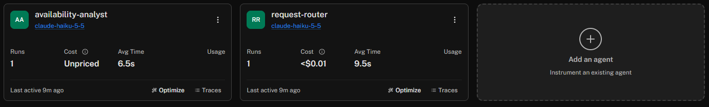
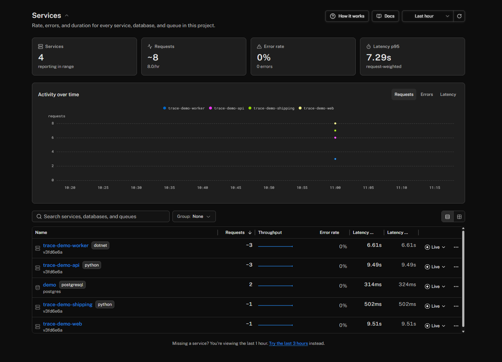

# Compatibility ledger (phase zero, recorded 15 October 2026)

Everything below was **observed** on this stack unless marked *not executed*. Documentation and `main` branches are
mutable; the source references point at the released tags that were actually installed.

## Runtimes and images

| Component | Pin | Notes |
|---|---|---|
| .NET SDK | `global.json` 10.0.301, `rollForward: latestFeature`; image `mcr.microsoft.com/dotnet/sdk:10.0.302-noble@sha256:72dd7437…` | `test.runner = Microsoft.Testing.Platform` is required: xunit.v3 4.0.2 only runs on MTP and the .NET 10 SDK refuses the VSTest path for it |
| ASP.NET runtime | `mcr.microsoft.com/dotnet/aspnet:10.0.9-noble@sha256:7644f992…` | curl added for the healthcheck only |
| Python | 3.14.8 in `python:3.14.8-slim-trixie@sha256:a2b82f3c…` (host 3.14.7); `requires-python ==3.14.*` | |
| uv | 0.12.24 (`ghcr.io/astral-sh/uv:0.12.24@sha256:3af4716e…`) | |
| Node | 24.22.0 (`node:24.22.0-alpine3.24@sha256:44fce696…`) for the web build | |
| nginx gateway | `nginx:1.31.7-alpine@sha256:42c36dfd…` | |
| Playwright | `mcr.microsoft.com/playwright:v1.64.1-noble@sha256:7852dc5a…` + `@playwright/test` 1.64.1 | |
| PostgreSQL | `postgres:18.6-alpine3.24@sha256:77f58511…` | |
| Collector | `otel/opentelemetry-collector-contrib:0.162.0@sha256:39923a8e…` | both configs pass `validate` with this binary |
| Host used for this record | Windows 11, Docker 29.8.2, Compose 5.5.1 | |

No floating tags are used anywhere; every image is `tag@digest`.

## Packages

| Runtime | Package | Version | Role |
|---|---|---|---|
| Python | pydantic-ai-slim[mcp,anthropic] | 2.56.0 | `request-router` agent, `MCPToolset`, instrumentation |
| Python | fastmcp-slim | 4.1.0 | MCP client under `MCPToolset` |
| Python | mcp | 2.3.0 | JSON-RPC dispatcher; injects `params._meta` trace context (SEP-414) |
| Python | **httpx2** | 2.13.1 | the HTTP library MCP actually uses (not legacy httpx) |
| Python | anthropic | 1.14.0 (transitive) | live mode only |
| Python | fastapi / uvicorn | 0.143.1 / 0.54.0 | |
| Python | opentelemetry-api / -sdk / -exporter-otlp-proto-http | 1.45.1 | one TracerProvider + one LoggerProvider |
| Python | opentelemetry-instrumentation-fastapi / -logging | 0.66b1 | the logging package replaces the SDK `LoggingHandler` deprecated in 1.45 |
| .NET | Microsoft.Agents.AI | 1.25.0 | `availability-analyst` `ChatClientAgent` + `UseOpenTelemetry` |
| .NET | Microsoft.Extensions.AI | 10.11.0 | chat-client OTel, `FunctionInvokingChatClient` |
| .NET | ModelContextProtocol.AspNetCore | 2.2.0 | MCP server at `/mcp` |
| .NET | Anthropic | 12.57.0 | live mode `IChatClient` (`AsIChatClient`), SDK's own OTel off to avoid duplicate model spans |
| .NET | Npgsql / Npgsql.OpenTelemetry | 10.0.3 / 10.0.3 | locked together (experimental tracing) |
| .NET | OpenTelemetry.Extensions.Hosting / Exporter.OpenTelemetryProtocol | 1.19.1 | |
| .NET | OpenTelemetry.Instrumentation.AspNetCore / .Http | 1.19.0 | |
| .NET (tests) | xunit.v3 | 4.0.2 | |
| Browser | @opentelemetry/api | 1.9.1 | |
| Browser | sdk-trace-web, core, resources | 2.12.0 | lockstep family with the 0.223.0 experimental packages |
| Browser | instrumentation-fetch, instrumentation, exporter-trace-otlp-proto, sdk-logs, api-logs, exporter-logs-otlp-proto | 0.223.0 | |
| Browser | semantic-conventions | 1.43.0 | |
| Browser | react / react-dom | 19.3.1 | |
| Build | vite 8.3.4, @vitejs/plugin-react 6.1.2, **typescript 7.0.2** | | TS 7 (native compiler) worked for both web and e2e; no 5.x fallback needed |

No prerelease packages were required. **pnpm** is not installed on the reference host, so the two JS projects use
**npm** lockfiles (no root workspace: `apps/web` and `tests/e2e` are independent).

### Lockfiles (sha256)

| File | sha256 |
|---|---|
| `apps/api/uv.lock` | `ae8b9d9adea403b72e406fda42b782e2e3f6f027d190170c0c159d80126794bb` |
| `apps/web/package-lock.json` | `399e628956710d1df172c8919963a5d15cc9536977a54558aa09a6b59bc4fabf` |
| `tests/e2e/package-lock.json` | `21cfa17281a52e76afca73129b70c5e80ce9b80304b17b12cc04780547ae8c82` |
| `Directory.Packages.props` | `20bedb9fc6b2c813ca3cf2fef941877082b2239c7d009ec1a104e46b300e1787` |
| `apps/worker/packages.lock.json`, `apps/worker/Tests/packages.lock.json` | NuGet lock files (`RestorePackagesWithLockFile`, restored with `--locked-mode` in the image and CI) |

Recompute with `sha256sum <file>` when a dependency PR lands and re-run the full experiment matrix.

## Observed protocol and carrier behaviour

| Question (spec §18 "unresolved until implementation") | Observed answer |
|---|---|
| MCP protocol revision | **2026-07-28**, negotiated by `mcp` 2.3.0 ↔ C# SDK 2.2.0 via `server/discover` (no `initialize`). There are no protocol sessions; the C# server's default (and only non-obsolete) mode is **stateless** — `Stateful` is marked obsolete (MCP9006). `mcp.session.id` on server spans is a fresh random value per request. |
| Native Python→C# `_meta` behaviour | **Works natively, no bridge.** `mcp` 2.3.0 `JSONRPCDispatcher` opens CLIENT `MCP send tools/call <tool>` and calls `opentelemetry.propagate.inject(params._meta)` ([mcp/shared/jsonrpc_dispatcher.py, 2.3.0]). C# SDK 2.2.0 `McpSessionHandler.HandleMessageAsync` starts SERVER `tools/call <tool>` with `parentContext = extract(params._meta)` and `links = [Activity.Current]` ([McpSessionHandler.cs@v2.2.0](https://github.com/modelcontextprotocol/csharp-sdk/blob/v2.2.0/src/ModelContextProtocol.Core/McpSessionHandler.cs), [Diagnostics.cs@v2.2.0](https://github.com/modelcontextprotocol/csharp-sdk/blob/v2.2.0/src/ModelContextProtocol.Core/Diagnostics.cs)). |
| Fallback when `_meta` has no context | C# falls back to `Activity.Current`, which is the ASP.NET `POST /mcp/` server activity because message handling runs under the HTTP request's `ExecutionContext`. Verified by the `meta-removed` experiment. |
| Link behaviour | The MCP server span always links to the ASP.NET server span (same trace in baseline; **different trace** in `headers-removed`). |
| HTTP header carrier on Python→.NET | **Absent out of the box.** FastMCP 4 / mcp 2 send through **httpx2**, which has no OpenTelemetry instrumentor (`opentelemetry-instrumentation-httpx2` on PyPI is a 0.0.0 placeholder; `opentelemetry-instrumentation-httpx` 0.66b1 patches legacy httpx only). Closed by one narrow adapter, `apps/api/src/api/mcp_adapter.py` (removal condition in its docstring). |
| FastMCP's own client span | `fastmcp.settings.telemetry_mode = "propagation_only"`. In `native` mode FastMCP adds a second CLIENT span (`tools/call <tool>`, scope `fastmcp`) and injects `_meta` itself — but the `mcp` dispatcher re-injects and overwrites it, so the message parent is `MCP send …` either way. We drop the duplicate span. |
| Tool listing during a submission | None. `server/discover` and `tools/list` run once in the API lifespan (separate root traces, excluded from the per-submission graph); each submission sends exactly one MCP request (`tools/call`). |
| ActivitySource names (.NET) | `Experimental.ModelContextProtocol`, `Experimental.Microsoft.Agents.AI`, `Experimental.Microsoft.Extensions.AI`, plus instrumentation libraries `Microsoft.AspNetCore`, `System.Net.Http`, `Npgsql`. Discovered with a temporary catch-all `ActivityListener`, then registered explicitly (the catch-all was removed because it changes the graph: unregistered runtime sources start producing activities). |
| `execute_tool lookup_availability` owner | M.E.AI `FunctionInvokingChatClient`; it uses the agent's ActivitySource because `invoke_agent` is current. No application wrapper span exists. |
| Npgsql attribute schema | New conventions: `db.system.name=postgresql`, `db.namespace`, `db.query.text` (placeholders only, no bind values), `server.address/port`, plus `db.npgsql.*`. First use emits a separate `CONNECT demo` CLIENT span. |
| HTTP semconv | ASP.NET Core / HttpClient / our httpx2 adapter / browser fetch: stable names (`http.request.method`, `http.response.status_code`, `url.full`). FastAPI instrumentation 0.66b1 defaults to the **old** names (`http.method`, `http.status_code`, `http.target`); we did not set `OTEL_SEMCONV_STABILITY_OPT_IN=http` because it also records `url.query`. |
| Trace flags | Python 1.45 emits `03` (sampled + random-trace-id flag); do not hardcode `-01`. |
| Browser async context | `StackContextManager` (zone.js cannot patch native async/await; Vite 8 emits native async). The fetch is started synchronously inside `ui.ask`'s active context so the CLIENT span parents correctly. After `await` the ambient span is **gone**: `demo.context_after_await=false` on every recorded run; the log record re-enters context explicitly. |
| Browser fetch span timing | instrumentation-fetch 0.223.0 ends the CLIENT span ~300 ms after the response (`OBSERVER_WAIT_TIME_MS`, waiting for resource timing). A flush right after rendering would lose it; `flushTelemetry()` waits for open spans (≤2 s) before force-flushing. |
| OTLP endpoint (.NET 1.19) | Base `OTEL_EXPORTER_OTLP_ENDPOINT` → `/v1/traces` and `/v1/logs` appended. A base that already ends in `/v1/traces` keeps traces but sends logs to `/v1/traces/v1/logs`. Signal-specific `OTEL_EXPORTER_OTLP_TRACES_ENDPOINT` is ignored by `AddOtlpExporter()` (only `UseOtlpExporter()` reads it). An **empty** base endpoint silently falls back to `http://localhost:4318`. .NET does not read `OTEL_PROPAGATORS`; its default is W3C trace context. |
| OTLP endpoint (Python 1.45) | Base endpoint → `/v1/traces`, `/v1/logs` appended; honours `OTEL_PROPAGATORS=tracecontext` (verified: no baggage in headers or `_meta`). |
| Logfire export and rendering | Executed 15 Oct 2026 (`up --mode live --logfire`, EU region): zero Collector exporter errors, and the trace was inspected in the Logfire UI — see *Logfire observations* below. |
| Live models | Executed once (see *Live run record* below): Anthropic `claude-haiku-5-5` in both agents, tool invoked as required, full trace contract passes. |

## Live run record (15 Oct 2026, commit `3fd6e6a` + live fixes)

`demo up --mode live --logfire` → `run --scenario baseline` → `verify`: **all 16 checks pass**, one trace of 23 spans
(run `5bb43a35…`, trace `1c73f18c…`), outcome `ok`, ≈9.5 s end to end, SQL/HTTP overlap 327 ms, no canaries.

| Agent | Model calls | Returned model | Input / output tokens | Finish reasons |
|---|---|---|---|---|
| `request-router` (Pydantic AI) | 2 (1.2 s, 1.6 s) | `claude-haiku-5-5` | 641/94, 977/214 → 1,618 / 308 | `tool_call`, `stop` |
| `availability-analyst` (MAF) | 2 (4.3 s, 1.6 s) | `claude-haiku-5-5` | 1,334/94, 1,606/239 → 2,940 / 333 | `tool_calls`, `stop` |

Total ≈ 4,558 input and 641 output tokens per submission; within the caps (router: 3 requests, 1 tool call,
20k tokens; analyst: `DEMO_MAX_OUTPUT_TOKENS=512`). Pricing was not recorded. Both models called their tool on
the first turn (1/1 runs; a single run says nothing about the miss rate).

Observed only in live mode:

- **Anthropic Python SDK 1.14.0 traces by default.** With a global TracerProvider registered it emits its own
  CLIENT span `anthropic.messages.create` (scope `com.anthropic.sdk.python`, status OK) *under* Pydantic AI's
  `chat claude-haiku-5-5` span — two owners for one model call. It also injects trace context into requests to
  `api.anthropic.com` (`propagation` defaults to true). Content capture stays off unless
  `ANTHROPIC_OPEN_TELEMETRY_TRACES_CONTENT_MODE=content`. Controls: client option `open_telemetry=False` or
  `ANTHROPIC_OPEN_TELEMETRY=false` / `ANTHROPIC_OPEN_TELEMETRY_PROPAGATION=false`. Not changed yet — recorded as found.
- **.NET:** the Anthropic .NET SDK's own tracing is off (set by us), but HttpClient instrumentation records the
  provider call as `POST` CLIENT to `api.anthropic.com` under each `chat` span and sends `traceparent` to the provider.
- **Usage keys collide on .NET.** MAF puts the agent's *aggregate* usage on `invoke_agent` under the same
  `gen_ai.usage.*` keys the `chat` spans use (2,940 = 1,334 + 1,606). Summing every span's `gen_ai.usage.input_tokens`
  double-counts. Pydantic AI uses `gen_ai.aggregated_usage.*` on its agent span instead.
- **Finish-reason vocabulary differs:** Pydantic AI `['tool_call']` (array) vs M.E.AI `"[\"tool_calls\"]"` (JSON string).
- **Compose gotcha fixed:** `ANTHROPIC_BASE_URL: ${ANTHROPIC_BASE_URL:-}` handed the API an empty string, which the
  Python client takes as a URL. Compose now passes it through only when set, and the API treats empty as unset.

### Logfire observations (same trace, inspected in the Logfire UI, EU region)

- **One waterfall, four services.** Logfire draws the whole submission as a single tree rooted at `ui.ask`; every
  row carries its resource service (`trace-demo-web` / `-api` / `-worker` / `-shipping`). Facets for the trace:
  23 spans, 12 logs, 10 events (worker 21 records, api 11, web 11, shipping 2). Log records and span events
  (fetch resource timing, `lookup_availability.join`, Npgsql `received-first-response`) appear inline under the
  span that was active when they were emitted.
- **SQL/HTTP overlap.** At the full-trace scale (9.5 s) the two leaf bars are a few pixels wide, so the overlap is
  not something you can *see* in the waterfall. Logfire's stored timestamps (span Raw Data) match the raw OTLP
  exactly: `execute_tool lookup_availability` 10:01:32.308485–.849696, `GET` .333986–.838330, `postgresql`
  .431996–.758557 → **326.6 ms overlap**, tool ends after both. The SQL span starts 98 ms after the HTTP span
  because the pooled connection's first `CONNECT demo` (84 ms) runs first on that branch.
- **Agent and tool names.** Python spans are displayed with Pydantic AI's message text rather than the OTLP span
  name: `request-router run` (span `invoke_agent request-router`) and `running tool: build_availability_report`
  (span `execute_tool build_availability_report`). .NET spans keep their raw names
  (`invoke_agent availability-analyst(availability-analyst)`, `execute_tool lookup_availability`). The **Agents**
  page detects both agents from the GenAI attributes — `request-router` and `availability-analyst`, both
  `claude-haiku-5-5`, 1 run each — but prices only the Python one (`<$0.01`); the .NET agent shows **Unpriced**.
  The agent-run panel shows messages as **Not captured**, consistent with content capture being off.
- **Links are visible.** The .NET `tools/call build_availability_report` row shows a link icon, and its Details tab
  lists *Related spans → Links to → `POST /mcp/`* (clickable). In this baseline the link target is in the same
  trace; the cross-trace case (`headers-removed`) was not inspected in the UI.
- **Token roll-ups double-count.** The Σ badge on `ui.ask` reads **5,892 in / 735 out**, while the four model calls
  total 4,558 / 641. The `tools/call` subtree reads 4,274 / 427 = MAF's aggregate on `invoke_agent` (2,940 / 333)
  plus its first `chat` span (1,334 / 94) — the `gen_ai.usage.*` key collision above, visible in the UI.
- **.NET log bodies show templates.** Worker records render as `lookup_availability branch completed {demo.branch}
  {demo.duration_ms}` and `{EndpointName} method '{Method}' request handler called.`: the .NET OTLP log exporter
  sends the message *template* as the body (values are in attributes). Python records show formatted text.
  `IncludeFormattedMessage = true` on the .NET logging options would change that; not changed.
- **Privacy in the UI.** No prompt, completion or tool argument/result text appears anywhere in the trace. MCP
  session ids are present as span attributes (`mcp.session.id`), so the saved screenshots leave out attribute panes.

- **Services view.** Lists the four resource services with a runtime badge (`dotnet` for the worker, `python`
  for the API and stub, none for the browser) and the `service.version` from `OTEL_RESOURCE_ATTRIBUTES`, plus a
  fifth entry, **`demo` (postgresql)**, inferred from the Npgsql client spans (`db.namespace=demo`) even though
  PostgreSQL itself exports nothing. Error rate 0% across the live runs.

### Content capture on (live, `run --scenario privacy`, trace `a268b981…`)

With `DEMO_CONTENT_CAPTURE=true` both frameworks record messages. Every structural check still passed (overlap
327 ms); only `privacy-canaries` failed, as designed — the prompt canary and the shipping-reference canary (which
travels only inside tool results) appeared. Which spans carried content:

| Runtime | Span | Content attributes |
|---|---|---|
| Python | `invoke_agent request-router` | `pydantic_ai.all_messages`, `final_result`, `gen_ai.system_instructions` |
| Python | `chat claude-haiku-5-5` | `gen_ai.input.messages`, `gen_ai.output.messages`, `gen_ai.system_instructions` |
| Python | `execute_tool build_availability_report` | `gen_ai.tool.call.arguments`, `gen_ai.tool.call.result` |
| Python | `anthropic.messages.create` (Anthropic SDK) | **none** — its content mode is separate (`ANTHROPIC_OPEN_TELEMETRY_TRACES_CONTENT_MODE`) and stayed off |
| .NET | `invoke_agent availability-analyst(…)` | `gen_ai.input.messages`, `gen_ai.output.messages` |
| .NET | `chat claude-haiku-5-5` | `gen_ai.input.messages`, `gen_ai.output.messages`, `gen_ai.system_instructions` |
| .NET | `execute_tool lookup_availability` | `gen_ai.tool.call.arguments`, `gen_ai.tool.call.result` |

The MCP spans (`MCP send …`, C# `tools/call …`) and the HTTP spans carry no content in either setting.

Logfire turns these into conversation panels. The Python agent span gets an **Agent Run** tab (prompt → tool call
with request/result JSON → answer); the .NET `invoke_agent` span — kind CLIENT with model attributes — gets a
**Model Run** tab instead, showing the analyst's own input, the `lookup_availability` call and its JSON report.

| Python `request-router` (Agent Run) | .NET `availability-analyst` (Model Run) |
|---|---|
|  |  |

The stack was switched back to capture **off** right after this run.

## Graph profile accepted

**Message-first** (spec §5): the .NET MCP server operation's parent is the Python `MCP send tools/call …` CLIENT
span (from `_meta`), and it carries a link to the .NET `POST /mcp/` server span, whose own parent is the Python
`POST` CLIENT span (from the header). See [propagation-contract.md](propagation-contract.md).

## Observed Python vs .NET differences (same trace, different vocabulary)

| Concept | Python (Pydantic AI 2.56 / mcp 2.3) | .NET (MAF 1.25 / M.E.AI 10.11 / MCP C# 2.2) |
|---|---|---|
| Agent span | `invoke_agent request-router`, kind **INTERNAL**, `gen_ai.agent.name`, `gen_ai.agent.call.id`, aggregated usage | `invoke_agent availability-analyst(availability-analyst)`, kind **CLIENT**, `gen_ai.agent.id`, `gen_ai.agent.name`, `gen_ai.provider.name` (fixed agent id, else the name embeds a GUID) |
| Model span | `chat scripted-router` CLIENT, `gen_ai.provider.name=function`, **estimated** `gen_ai.usage.*` → we add `demo.model.synthetic=true`; live: `chat claude-haiku-5-5` + the Anthropic SDK's own `anthropic.messages.create` child | `chat scripted-analyst` CLIENT, no usage attributes (scripted client reports none); live: `chat claude-haiku-5-5` + HttpClient `POST` child |
| Agent usage | `gen_ai.aggregated_usage.*` on the agent span | aggregate under the same `gen_ai.usage.*` keys as model spans |
| Tool span | `execute_tool build_availability_report` INTERNAL (Pydantic AI) | `execute_tool lookup_availability` INTERNAL (FunctionInvokingChatClient) |
| MCP span | CLIENT `MCP send tools/call <tool>`: `mcp.method.name`, `jsonrpc.request.id`; scope `mcp-python-sdk` (no version) | SERVER `tools/call <tool>`: `mcp.method.name`, `jsonrpc.request.id`, `gen_ai.tool.name`, `gen_ai.operation.name=execute_tool`, `network.transport`, `network.protocol.name`, `mcp.session.id`; no `mcp.protocol.version` |
| Logical tool error | `execute_tool` + `invoke_agent` ERROR with `exception.type` only; `MCP send` and HTTP `POST` stay UNSET (HTTP 200) | MCP server span ERROR, `error.type=tool_error`; status description is the result text (fixed, content-free) |
