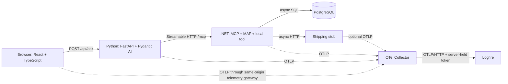

# One request, several runtimes, one trace

## Project specification

**Status:** implementation blueprint; no application has been built or integration-tested as part of this document.
**Documentation checked:** 15 October 2026.
**Purpose:** demonstrate, measure, deliberately break, and repair OpenTelemetry trace continuity through a browser, two agent frameworks, MCP, SQL, and HTTP. Produce a reproducible monorepo and an evidence-led article.

The target chain is:

**React/TypeScript browser → FastAPI → Pydantic AI agent → MCP over Streamable HTTP → ASP.NET Core MCP server → Microsoft Agent Framework agent → local asynchronous tool → concurrent PostgreSQL and outbound HTTP operations.**

Every instrumented application exports OTLP to a shared OpenTelemetry Collector, which forwards traces to one Logfire project. The Collector transports telemetry; it does not repair missing parent relationships. A common destination, matching service names, request IDs, or MCP session IDs cannot join unrelated traces.

## 1. Outcomes and acceptance criteria

The demonstrator should answer four questions with captured evidence:

1. Does one browser submission retain a trace ID across every process boundary?
2. Are the parent IDs correct, including MCP's distinction between message and transport operations?
3. Do two asynchronous downstream operations actually overlap under the same local tool invocation?
4. When continuity breaks, which boundary failed, why, and what exact change fixes it?

The baseline passes when:

- A Playwright-driven submission produces a result using both database inventory and an HTTP shipping quote.
- A finished browser interaction span, FastAPI server span, both agent invocations, MCP operation, .NET local tool, database client span, and outbound HTTP client span are exported.
- All required spans share the browser interaction's trace ID. Every required non-root span has a recorded parent in the captured trace, apart from explicitly documented external or excluded instrumentation.
- MCP message parentage matches the selected SDK profile; HTTP parentage is independently verified.
- The two leaf I/O spans overlap. Their local tool parent ends after both branches finish.
- Twenty simultaneous independent submissions do not cross-parent or reuse another request's trace context.
- The same trace is visible in Logfire, with distinct resource service names and the parallel branches. Raw OTLP assertions remain the authoritative test if the UI groups spans differently.
- Default telemetry contains no prompts, completions, tool arguments/results, credentials, cookies, personal data, SQL parameter values, or unredacted URLs containing secrets.
- Each deliberate break has a failing assertion, a minimal fix, and a passing rerun on the same pinned stack.

Exclude unrelated page-load traces, readiness requests, telemetry export traffic, and pre-established MCP connection setup from the one-submission completeness test. If initialization occurs during the submission, capture and explain those extra spans rather than deleting evidence.

## 2. Workload and application contracts

Use a small synthetic product-availability assistant. Example input: “Can I get the demo lantern delivered to DEMO-NORTH?” It has no real customer data and performs no purchases or writes to business systems.

### Public API

`POST /api/ask` accepts an application-defined JSON object:

```json
{
  "message": "Can I get the demo lantern delivered to DEMO-NORTH?",
  "product_code": "DEMO-LANTERN",
  "destination_zone": "DEMO-NORTH"
}
```

Limit message length to 2,000 characters; validate product and destination against seeded enumerations. Generate an opaque `run_id` on the server. Return `run_id`, `answer`, structured `evidence`, and a diagnostic `trace_id` in local-demo mode. Do not treat the trace ID as an access token or use it to authorize trace access. A body field is sufficient; an optional `X-Trace-Id` response header needs CORS exposure if read cross-origin.

### Agent and tool responsibilities

- **Pydantic agent, `request-router`:** interpret the request, call the one allowed remote MCP tool, then summarize its result. Use client-side MCP execution; provider-hosted/native MCP would move the execution boundary outside this experiment.
- **Remote MCP tool, `build_availability_report`:** validate arguments and invoke the .NET agent inside the current message context. Never accept user-supplied URLs or raw SQL.
- **MAF agent, `availability-analyst`:** call local `lookup_availability`, then produce a structured availability report.
- **Local tool, `lookup_availability`:** launch stock lookup and shipping quote concurrently, await their join, and return both results. The concurrency is implemented by the tool, not left to model planning.
- **PostgreSQL:** seeded stock table; read-only role; parameterized query by product code.
- **Shipping stub:** deterministic HTTP endpoint with configurable latency and failure response. Optionally instrument its server span to demonstrate a final cross-process hop.

Define shared JSON Schemas for API input/output, MCP arguments/results, and local result DTOs. Test semantic equivalence between Pydantic models and C# DTOs. Do not expose tracing metadata as business tool arguments or ask either model to copy it.

### Two execution modes

1. **Deterministic CI mode:** inject a scripted model implementation at each framework's model/client abstraction. It requests the named tool once, consumes its result, and returns fixed structured output. Run the real agent loops, actual MCP network transport, real PostgreSQL, and real HTTP stub. A direct-function shortcut is useful for unit tests but cannot pass the agent-chain acceptance gate.
2. **Live-model mode:** use configured providers and model IDs supported by each pinned framework. Record provider/model versions and cap requests, tokens, time, and cost. Model selection is separate from the tracing claim. Tool invocation is nondeterministic unless the selected provider supports and correctly implements the required tool-choice control; record missed tool calls as workload failures.

## 3. Architecture and service boundaries



| Runtime | `service.name` | Responsibilities |
|---|---|---|
| Browser | `trace-demo-web` | interaction, HTTP client span, browser export |
| Python process | `trace-demo-api` | ASGI server, agent, model client, MCP client and its HTTP transport |
| .NET process | `trace-demo-worker` | ASP.NET server, MCP server operation, MAF agent, model client, local tool, SQL/HTTP clients |
| HTTP fixture | `trace-demo-shipping` | optional server-side shipping span |

Agents and tools within a process are spans, not separate services. PostgreSQL does not need an OTel SDK for a client query span to exist; a database server trace is outside the baseline. External model-provider internals are also outside visibility: show local inference-client spans, not invented provider-side spans.

Assign `service.namespace=trace-continuity-demo`, `service.version=<git SHA>`, and `deployment.environment.name=local|ci|demo` to each resource. Give each process a distinct instance ID if useful. Do not use a new service name for every request. Keep `demo.run_id` on selected spans/logs, never a metric dimension.

## 4. Capability verification and version policy

Documentation establishes available features; it does not establish that a particular combination has been tested. The following are current documentation observations, not a dependency lockfile.

| Component | Verified documentation | Implementation consequence |
|---|---|---|
| Pydantic MCP client | Current docs expose `MCPToolset` and remote Streamable HTTP; they distinguish FastMCP 3's HTTPX from FastMCP 4's HTTPX2 | Pin the transport dependency too. Do not assume legacy `MCPServerStreamableHTTP` snippets or HTTPX instrumentation cover the chosen stack. [S1] |
| Pydantic telemetry | Raw OTel providers and `Agent.instrument_all()` are documented; content exclusion is configurable | Use one explicit provider/export route; verify privacy against actual exported data. [S2] |
| MAF .NET | Agent and chat-client OTel middleware and explicit source subscription are documented | Instrument the agent and model client deliberately; subscribe to their configured source names. [S3] |
| C# MCP | Official SDK source has message `_meta` extraction/injection and `Experimental.ModelContextProtocol` ActivitySource | Subscribe to that source for the pinned release; source on `main` is not proof of behavior in an older NuGet package. [S4] |
| MCP protocol | 2026-07-28 reserves unprefixed tracing keys in `_meta`; older revisions and transport behavior differ | Record the protocol revision actually used. Do not mix modern per-request metadata rules with older initialization/session assumptions. [S5, S6] |
| MCP semantics | Current GenAI conventions describe message propagation and HTTP transport links | Test graph relationships, not just visual nesting. These conventions are version-sensitive. [S7] |
| Browser export | OTel documents browser HTTP exporters and CORS considerations | Use OTLP/HTTP, not browser gRPC; exclude telemetry requests from fetch instrumentation. [S8] |
| Npgsql | Npgsql documents OTel tracing as experimental | Lock Npgsql and its telemetry integration together; verify emitted attributes. [S9] |
| Logfire | Standard OTLP Collector export is documented | No Logfire-specific SDK is required in application processes. [S10] |

### Phase-zero compatibility gate

Create `docs/compatibility.md` before building the full system. Record exact package/runtime versions, release URLs, lockfile hashes, instrumented HTTP library, MCP protocol revision, source names, semantic convention formats, and documentation/source commit references. Fill in observed behavior from a two-process probe.

Suggested starting runtimes are Node.js 24 LTS, Python 3.12, and .NET 10; these are project choices to validate against package requirements, not a claim of a tested version matrix. Pin React, TypeScript, Vite, OTel JS, FastAPI, Pydantic AI, FastMCP/MCP dependencies, OTel Python, MAF, C# MCP, OTel .NET, Npgsql, PostgreSQL, and Collector image digests. Never publish the reproduction using floating `latest` tags.

First attempt the current compatible stable package set. If a framework requires prerelease packages, identify each one and its rationale. If the current FastMCP HTTP stack lacks a suitable instrumentor, either implement a narrow supported transport hook with tests or pin a supported older transport deliberately. Record the tradeoff; do not silently lose HTTP client spans.

No custom MCP bridge should be enabled until a probe shows that built-in instrumentation fails the selected contract. Wrap compatibility code in one small adapter with a removal condition.

## 5. Trace identity, parenting, and MCP carriers

W3C `traceparent` carries a trace ID, the transmitting span's ID, and flags. A receiver creates a new span ID; it does not reuse the sender's. `tracestate` carries vendor state, while baggage is a separate propagation mechanism. Use SDK propagators rather than string concatenation. [S11]

### Required graph

The conceptual graph below uses project labels. Actual framework names and optional wrappers must be recorded from the pinned implementation.

```text
ui.ask [browser INTERNAL; root for this submission]
└─ POST /api/ask [browser CLIENT]
   └─ POST /api/ask [Python SERVER]
      └─ invoke_agent request-router
         ├─ model request(s) [CLIENT]
         └─ MCP logical call: build_availability_report [CLIENT or reused tool span]
            ├─ POST /mcp [Python HTTP CLIENT]
            │  └─ POST /mcp [.NET HTTP SERVER]
            └─ MCP server operation [.NET SERVER]
               └─ invoke_agent availability-analyst
                  ├─ model request(s) [CLIENT]
                  └─ local tool lookup_availability
                     ├─ database query [CLIENT] ──────┐
                     └─ shipping HTTP [CLIENT] ──────┤ concurrent
                        └─ shipping server [SERVER]  │ optional
                     join after both complete ◀─────┘
```

For the message-first MCP profile, the MCP server operation is parented to the remote MCP client operation and linked to the local HTTP server span. It need not be a child of that HTTP server span. This is an intentional graph, not necessarily a break. The current MCP semantic conventions describe this arrangement; validate actual SDK behavior. [S7]

### Two distinct propagation carriers

**HTTP headers** relate HTTP operations. The browser's outbound client span context is injected into `/api/ask`; FastAPI extracts it. The Python transport injects its HTTP client span context into `/mcp`; ASP.NET extracts it. The .NET shipping client propagates to the shipping stub.

**JSON-RPC `params._meta`** relates MCP operations. Inject the current logical MCP/tool span context into the request at message creation. The MCP server extracts it before starting its operation. Preserve existing metadata such as progress tokens and protocol fields. Do not put `_meta` inside `arguments`, at the envelope top level, or only in the response. The 2026 protocol explicitly recognizes the unprefixed tracing keys. [S5]

Illustrative request fragment, not a complete protocol handshake:

```json
{
  "jsonrpc": "2.0",
  "id": 7,
  "method": "tools/call",
  "params": {
    "name": "build_availability_report",
    "arguments": {"product_code": "DEMO-LANTERN", "destination_zone": "DEMO-NORTH"},
    "_meta": {
      "traceparent": "00-11111111111111111111111111111111-2222222222222222-01"
    }
  }
}
```

The example IDs are explanatory constants; real SDKs generate them. The HTTP header may contain the same trace ID but a different parent span ID, because it represents the nested HTTP client operation. Do not overwrite it with `_meta.traceparent` to force identical parent IDs.

### Adapter behavior if a gap is proven

The following describes an algorithm, not an SDK callback API:

1. At the Python message-send boundary, make the logical operation current, inject through the configured propagator into a fresh carrier, and merge only allowed tracing fields into existing request metadata.
2. Never store trace headers on a singleton client's default headers at startup. Each request needs its own carrier and current context.
3. Let HTTP instrumentation inject its own nested transport context when it sends the request.
4. On .NET, prefer native MCP extraction. If missing, use a documented request filter/handler for the selected SDK to validate/extract message context before starting the operation; attach a link to the captured HTTP server context where supported.
5. If metadata is absent, a compatibility profile may retain valid HTTP context as parent. Label that profile explicitly and test it. Do not claim transport-independent propagation from a headers-only result.
6. Malformed context must not crash business handling. Discard invalid context and record a bounded diagnostic outcome without logging the incoming value. Conflicting trace IDs require an explicit trust policy and a dedicated negative test.
7. Restore ambient context in `finally`/scope disposal. Never alter already-created spans' parents or rewrite trace IDs downstream.

One span has one parent. Links express additional causal relationships; they do not merge separate trace IDs into a single waterfall. Session IDs, JSON-RPC request IDs, and `demo.run_id` are diagnostic correlation identifiers, not trace parents. Long-lived clients and connections must never make later requests children of the first request.

## 6. Explicit instrumentation ownership

| Layer | Owner and implementation requirement | Avoid |
|---|---|---|
| Browser interaction | One manual `ui.ask` span around submission through result consumption | Using an unrelated page-load span as the mandatory root |
| Browser HTTP | One fetch instrumentor or one manual HTTP wrapper | Double manual/automatic spans for the same request |
| FastAPI | Official FastAPI/ASGI instrumentation, configured before serving [S12] | Wrapping the same app twice through multiple distributions |
| Python agent/model/tool | Pydantic AI instrumentation using the configured OTel provider | Assuming an agent span proves transport injection |
| Python MCP transport | Instrument the actual HTTP implementation selected in phase zero | Installing an HTTPX instrumentor when traffic uses HTTPX2 |
| .NET HTTP server | ASP.NET Core instrumentation | A second manual server span around the entire request |
| MCP message | C# SDK diagnostics, plus only proven adapter gaps | Competing message extractors and duplicate tool spans |
| MAF | Agent OTel middleware plus chat-client instrumentation as appropriate | Treating Microsoft.Extensions.AI model spans as proof of agent coverage |
| Local tool | Framework tool span when available; otherwise one application-owned tool span | Adding a duplicate `execute_tool` wrapper blindly |
| SQL | Npgsql tracing integration [S9] | Inventing PostgreSQL server spans or logging SQL values |
| Outbound HTTP | OTel .NET HttpClient instrumentation | Shared mutable headers or a second manual HTTP CLIENT span |

Use one TracerProvider per runtime and one export route to the Collector. In .NET, subscribe to the explicit MAF source name, MCP source, and application ActivitySource; register ASP.NET Core, HttpClient, and Npgsql instrumentation. A custom `ActivitySource.StartActivity()` can return null without a listener or under sampling: application correctness must not depend on a non-null Activity.

Current MAF documentation illustrates `.AsBuilder().UseOpenTelemetry(...)` and `AddSource(...)`; these are verified concepts, but exact package combinations and overloads must compile in phase zero. Do not copy its sensitive-data-enabled sample defaults into this project. [S3]

For Python, prefer the raw OTel route plus Pydantic instrumentation. If Logfire SDK helpers are chosen instead, make their provider/exporter ownership explicit and disable direct backend export when routing through the Collector. Do not stack independent initializers. [S2]

For the browser, initialize telemetry once before React rendering. Keep the interaction context active when starting fetch and verify behavior after an `await`. Browser context-manager support varies by build/runtime; capture and explicitly re-enter context at callbacks if needed. Do not claim every JavaScript async boundary propagates automatically. Ensure React development behavior does not register instrumentation twice.

## 7. Semantic conventions and naming policy

Preserve native framework attributes. Store any comparison/normalization view separately; do not rewrite raw evidence to make SDKs appear identical. Record instrumentation scope name/version and available schema URLs in evidence.

| Category | Desired data and policy |
|---|---|
| HTTP | Method, route template where applicable, response status, server address/port, error classification; avoid raw query strings. Current conventions include `http.request.method` and `http.response.status_code`. [S13] |
| Database | System, namespace, operation and safe query summary; current conventions use attributes such as `db.system.name`, `db.namespace`, and `db.operation.name`. Actual Npgsql version may emit a different schema. [S14] |
| Agent | Agent name and `gen_ai.operation.name=invoke_agent` where supported; preserve SDK kind/naming and document deviations. [S15] |
| Model | Provider, requested/returned model, operation, actual usage if reported, and duration; never fabricate usage for scripted models |
| Tool | Stable tool name and execution outcome; arguments/results off by default |
| MCP | Protocol revision, method, request correlation and tool name; validate the emitted MCP convention version rather than adding generic RPC attributes by guesswork |
| Application | `demo.scenario`, `demo.mode`, `demo.run_id`, `demo.branch`, `demo.outcome`; all custom keys clearly namespaced |

GenAI and MCP conventions are evolving. Pin the convention/instrumentation format used in examples and maintain a table of observed Python/.NET differences. A framework's format version is not its package version. Do not globally set a semantic-convention opt-in variable unless the chosen instrumentor documents it.

Use stable span names with no prompt text, request IDs, raw product input, or URLs. A successful span may legitimately remain `UNSET`; do not require explicit `OK` everywhere. Distinguish a transport HTTP 200 from an MCP tool result indicating failure. Mark the failed logical operation appropriately even if HTTP succeeded. Caught recoverable errors may produce an error child under a successful overall request; tests should reflect the chosen policy.

Do not sum every nested duration to calculate request latency. Do not sum agent-level aggregate token counts with model-level usage. Start cost reporting as optional, with provider pricing date and estimation caveats.

## 8. Concurrent asynchronous SQL and HTTP

Use genuine async Npgsql and HttpClient calls. The local tool starts both tasks while its span is current, then awaits `Task.WhenAll`. Do not await the SQL task before creating the HTTP task. Avoid `Task.Run` for I/O and never use fire-and-forget work to fake overlap.

Illustrative C# control flow; helpers are application functions, not proposed SDK APIs:

```csharp
// Called inside the active framework tool span.
var stockTask = QueryStockAsync(productCode, cancellationToken);
var shippingTask = FetchQuoteAsync(destinationZone, cancellationToken);
await Task.WhenAll(stockTask, shippingTask);
return Combine(await stockTask, await shippingTask);
```

Each helper acquires its own required resources, honors cancellation, and disposes them. Keep the parent tool scope open through both completions. Normal .NET execution context flows across `await`; `ConfigureAwait(false)` alone is not a trace-context suppression mechanism. Deliberate loss experiments must suppress or detach execution context explicitly and document where restoration occurs.

Baseline failure policy: both branches are required; if either fails, the tool fails after observing both tasks. `Task.WhenAll` does not automatically cancel its sibling. A later fail-fast variant must use a linked cancellation source, cancel intentionally, and still observe/drain both tasks before ending the parent scope. Distinguish user cancellation, timeout, and downstream error.

Set fixture SQL latency around 300 ms and shipping latency around 500 ms, using controlled fixture behavior (for example, a demo-only PostgreSQL delay query and stub delay). Record the actual operation carrying the delay; do not insert all delay before the DB span and then claim query overlap.

For leaf intervals `[s_sql,e_sql]` and `[s_http,e_http]`, assert:

```text
overlap = min(e_sql, e_http) - max(s_sql, s_http)
overlap > 0
parent.end >= max(e_sql, e_http)
```

These two client spans share the same .NET host clock. Use overlap as the hard correctness test; use approximate `max(branch durations)` versus their sum as an explanatory measurement with tolerance. Keep model latency outside this tool-level comparison. An optional join event after completion is sufficient; the join does not require a synthetic two-parent span.

## 9. Collector, Logfire, and configuration

### Network and routing defaults

- Expose the web gateway on loopback, for example port 5173. Route `/api` to FastAPI and `/telemetry/v1/traces` to the Collector's `/v1/traces`.
- Keep Python, .NET, database, and Collector private on the Compose network; publish optional diagnostic ports only to `127.0.0.1`.
- Use an explicit cross-origin browser/API profile for the CORS experiment. Same-origin proxying is the normal baseline.
- The browser uses an HTTP/protobuf exporter and no Logfire credential. Backend services export to `http://otel-collector:4318` with `http/protobuf`.
- One Logfire project and region receive all services. The Collector alone receives its write credential.

For cross-origin API calls, configure an exact propagation URL allowlist and allow `traceparent`, `tracestate`, and selected application headers in the API CORS response. Baggage is disabled by default. API CORS and telemetry-ingestion CORS are separate configurations; successful export does not prove request propagation.

### Proposed environment contract

```dotenv
# Backends; resource service name differs per process.
OTEL_EXPORTER_OTLP_ENDPOINT=http://otel-collector:4318
OTEL_EXPORTER_OTLP_PROTOCOL=http/protobuf
OTEL_PROPAGATORS=tracecontext
OTEL_TRACES_SAMPLER=parentbased_always_on
OTEL_RESOURCE_ATTRIBUTES=service.namespace=trace-continuity-demo,deployment.environment.name=local

# Collector only; choose the region of the actual project.
LOGFIRE_OTLP_ENDPOINT=https://logfire-eu.pydantic.dev
LOGFIRE_TOKEN=replace-locally

# Application-defined settings; implement their readers explicitly.
DEMO_MODE=scripted
DEMO_SCENARIO=baseline
DEMO_CONTENT_CAPTURE=false
DEMO_MCP_URL=http://worker:8080/mcp
DEMO_REQUEST_TIMEOUT_SECONDS=30
```

Environment variable support differs across SDKs. Explicitly map these values into .NET and browser configuration where required. Browser build variables are public and do not inherit a backend process environment. `DEMO_*` names above are this repository's contract, not vendor SDK options. Use bounded branch/model timeouts within the overall deadline.

The generic OTLP base endpoint has no signal suffix; a signal-specific traces endpoint includes `/v1/traces`. Test this distinction rather than assuming every exporter appends paths the same way.

### Collector sketch

This is a configuration starting point to validate with the pinned Collector distribution. It is not a tested deployment file. Compose interpolation may require escaping `$` when configuration is embedded in Compose; prefer mounting a separate YAML file.

```yaml
receivers:
  otlp:
    protocols:
      http:
        endpoint: 0.0.0.0:4318

processors:
  memory_limiter:
    check_interval: 1s
    limit_mib: 256
    spike_limit_mib: 64
  batch:
    timeout: 1s

exporters:
  otlphttp/logfire:
    endpoint: ${env:LOGFIRE_OTLP_ENDPOINT}
    headers:
      Authorization: "Bearer ${env:LOGFIRE_TOKEN}"

service:
  pipelines:
    traces:
      receivers: [otlp]
      processors: [memory_limiter, batch]
      exporters: [otlphttp/logfire]
```

The regional endpoint and Collector authentication pattern follow Logfire's official migration guide. Verify credential scope and region with a smoke export. [S10]

Add a **local evidence profile** that exports through a pinned Collector-contrib file exporter or a purpose-built test OTLP receiver. Verify the chosen file encoding and flush behavior; do not parse human-readable debug output as the only assertion source. In CI, omit the cloud exporter entirely. The Logfire profile can fan out to both evidence capture and Logfire.

Start with 100% sampled browser roots and parent-based backend sampling. No tail sampling in the baseline. Test unsampled parents separately. Tail sampling is an extension requiring complete trace routing, decision timing, late-span handling, and memory limits; it cannot recover spans never exported by an upstream head sampler.

Gracefully flush providers on test completion and process shutdown. The browser test flushes after the interaction ends. Do not rely on tab close to deliver its final span. Monitor Collector receive/export failures, queue pressure, rejected spans, and credentials errors. Document finite buffers and possible data loss; Collector export is not exactly-once storage.

## 10. Monorepo layout

```text
trace-continuity-demo/
  README.md
  LICENSE
  SECURITY.md
  .env.example
  compose.yaml
  package.json
  pnpm-lock.yaml
  global.json
  Directory.Packages.props
  apps/
    web/
      src/telemetry.ts
      src/AskPage.tsx
      src/api.ts
      package.json
    api/
      pyproject.toml
      uv.lock
      src/api/main.py
      src/api/telemetry.py
      src/api/agent.py
      src/api/mcp_adapter.py
      tests/
    worker/
      Worker.csproj
      Program.cs
      Telemetry/
      McpTools/
      Agents/
      Tools/LookupAvailability.cs
      Infrastructure/
      Tests/
    shipping-stub/
  contracts/
    ask.schema.json
    report.schema.json
    trace-expectations.schema.json
  infra/
    collector/otelcol.yaml
    collector/otelcol.ci.yaml
    gateway/
    postgres/init.sql
  tests/
    e2e/
    trace-contracts/
    fixtures/
    privacy/
  experiments/
    scenarios.yaml
    baseline/
    headers-removed/
    meta-removed/
    context-detached/
    serial-vs-parallel/
  scripts/
    demo.ps1
    demo.sh
    assert-traces.py
  docs/
    project-spec.md
    compatibility.md
    propagation-contract.md
    instrumentation-inventory.md
    troubleshooting.md
    decisions/
    article/
  .github/workflows/
    ci.yml
    live-smoke.yml
```

These are proposed paths to implement. Keep fault injection in explicit demo/test adapters, not hidden global patches. Every scenario should have a definition, expected graph difference, relevant assertions, fix instructions, and evidence manifest.

### Required developer command interface

Implement equivalent shell and PowerShell wrappers with these verbs:

```text
demo doctor                     # prerequisite, configuration, port checks
demo up --mode scripted          # build, start, seed, wait for readiness
demo run --scenario baseline     # browser request + run manifest
demo verify --run <id>           # collect and assert trace evidence
demo experiment headers-removed # fault, capture, expected-failure check
demo down                       # stop; preserve evidence and data by default
```

These are desired repository commands, not existing tools. `doctor` must report missing credentials only when the selected profile needs them. Provide one documented clean-checkout sequence. Use readiness checks for database and MCP, not fixed sleeps. Make destructive data reset a separate explicit verb.

## 11. Reproducible breakage and repair experiments

Every experiment records stack versions, commit, scenario, mode, protocol revision, run IDs, trace IDs, graph assertions, sanitized transport evidence, and before/after screenshots. Change one variable at a time. Verify the fault is actually active; a surviving alternative carrier is a valid result, not a failed experiment.

| Experiment | Controlled change | Expected diagnostic observation | Repair and pass criterion |
|---|---|---|---|
| Browser allowlist | Remove cross-origin API from fetch propagation targets | API receives no header; backend begins another trace, while browser export may still work | Restore narrow allowlist; API parent equals browser HTTP client span |
| Browser CORS | Reject `traceparent` preflight header | Browser request blocked; this is a transport failure, not just an orphan trace | Allow required headers/origin; request and trace succeed |
| Python HTTP injection | Strip trace headers at MCP egress; keep `_meta` | HTTP server may root separately while MCP operation remains attached through metadata | Restore transport instrumentation; all required spans share trace ID |
| MCP metadata | Remove tracing fields from `params._meta`; keep headers | Message parentage changes, or continuity survives only through HTTP fallback | Restore native message propagation or proven adapter; expected MCP parent restored |
| Both carriers | Strip headers and tracing metadata | .NET starts an independent trace | Restore both; graph contract passes |
| Metadata conflict | Inject valid metadata from an unrelated test trace | Explicit trust-policy behavior; no silent arbitrary merging | Reject/ignore conflicting carrier per documented policy and test diagnostic |
| Stale client context | Test-only reuse of first request's injected context | Second submission attaches to first trace | Per-message/per-request injection; concurrency isolation test passes |
| Missing .NET source | Omit MCP or MAF ActivitySource registration | HTTP spans remain, but logical layer is absent | Register correct source for locked version; expected logical spans present |
| Python transport mismatch | Instrument HTTPX while chosen transport uses another library | Logical MCP call present but HTTP client span/injection missing | Use correct instrumentor or documented transport hook |
| Async detachment | Test-only clear/suppress context when launching a branch | Branch becomes root or lacks expected parent | Launch under captured tool context; both leaf parents/ancestry correct |
| Serial I/O | Await SQL before starting HTTP | Same trace but no overlap; longer tool duration | Start both before join; overlap assertion passes |
| Duplicate setup | Enable two owners for one instrumentation layer | Duplicate spans for one operation | Remove duplicate registration; ownership inventory matches trace |
| Sampling | Send unsampled parent or inconsistent service samplers | Partial/no trace with sampling evidence | Restore baseline policy; do not fabricate missing spans |
| Export routing | Wrong project/region/credential or stopped Collector | Local spans exist but expected backend has no complete trace | Correct export config; distinguish export failure from propagation failure |
| MCP tool failure | Return logical failure with HTTP 200 | HTTP success with tool/agent failure | Verify logical status mapping and sanitized error recording |
| Slow/canceled branch | Timeout HTTP while SQL finishes; then cancel caller | Correct failed/canceled outcomes and closed scopes | Deadlines, cancellation forwarding, all tasks observed; no leaked work |

Add invalid/truncated/all-zero `traceparent` cases and two concurrent calls on a shared MCP client. Never reuse production credentials or capture full request bodies to diagnose propagation.

## 12. Tests and evidence model

### Unit and component tests

- API/DTO validation and fixed allowed SQL/HTTP targets.
- Metadata merge preserves unrelated fields; injection uses active context and does not mutate shared headers.
- Missing/invalid context is safe; carriers are isolated between calls.
- Local tool starts both branches, combines results, propagates cancellation, and observes both faults.
- Scripted clients drive actual framework tool calls and correctly label synthetic usage.
- Telemetry configuration creates one provider and registers intended sources once.

### Trace contract tests

Build a test reader for the pinned OTLP evidence format. Decode trace/span IDs consistently and index spans by `(trace_id, span_id)`. Keep links separate from parents. Use stable semantic/custom attributes to select operations; permit documented SDK wrappers rather than asserting one fragile total span count.

Assertions must cover:

1. Required services and operation categories exist after bounded export polling.
2. Required spans share one trace ID and have unique span IDs.
3. Parent references resolve within the expected captured subset/full trace as appropriate; the graph is acyclic.
4. Browser CLIENT → Python SERVER and Python HTTP CLIENT → .NET HTTP SERVER are correct direct pairs.
5. Logical MCP server parent equals logical client/tool span for the selected message-first profile; the HTTP server link is checked if the SDK supplies it.
6. Both agent invocations are ancestors of their corresponding downstream tool work.
7. SQL and shipping CLIENT spans descend from the same local tool, with positive overlap and parent completion after both.
8. Twenty parallel runs have no context leakage and no cross-trace parent links except the explicit conflict test.
9. Logical error cases have intended outcomes even under HTTP 200; secrets and content canaries are absent from all signals.
10. Telemetry exporter traffic does not recursively create an unbounded trace chain.

Cross-host timestamps can have clock skew; use trace IDs and parent IDs for causality. Avoid strict global start/end nesting tests across browser/server clocks. The concurrency comparison is safe on the same .NET clock.

### End-to-end and manual verification

Use Playwright to open the app, enter the fixed request, submit, wait for the structured answer, end and flush browser telemetry, and write the returned run/trace IDs. Poll capture until required spans arrive or a bounded timeout expires; report the missing categories, not just “trace not found.”

A live-model smoke test verifies the same structural contract when tools were actually invoked. It is separate from deterministic CI and requires opt-in secrets. Do not use an LLM judge to determine trace correctness.

For Logfire, inspect the exact trace ID and verify service grouping, SQL/HTTP overlap, agent/tool names, and logical versus HTTP errors. Save screenshots and sanitized raw evidence. Confirm whether links are visible in the current UI; absent link rendering is not proof the link is absent in OTLP. The initial article must not claim Logfire-specific GenAI panels render identically for Python and .NET until observed.

An evidence manifest should include schema version, git SHA, dependency-lock hashes, scenario, UTC timestamps, run/trace IDs, expected assertions, actual results, and sanitized artifact paths. Keep source-of-truth raw traces separate from presentation screenshots.

## 13. Security and privacy requirements

This is a local educational workload, but instrumentation can accidentally export more than the application returns.

- Keep Logfire and model credentials server-side. No public `VITE_*` credential variables, browser write tokens, or committed `.env` files.
- Restrict the browser telemetry gateway to the required OTLP endpoint/method/content type, enforce request limits and rate limits, and restrict origins. Origin checking alone is not authentication against arbitrary clients. Do not make the gateway an arbitrary URL forwarder.
- Bind development services to loopback/private networks. Use TLS and proper access controls for any remote deployment. Validate MCP origins and authorization according to the selected protocol/deployment; local demo configuration is not a production MCP security profile.
- Treat incoming trace context as untrusted correlation data. It never grants access. Public deployments need a policy for accepting remote IDs and sampling flags; a trusted local demo can preserve them to prove continuity.
- Baggage is off by default. If introduced, allow only bounded synthetic fields and drop them on external provider calls. Never put identity, prompt text, credentials, or user input in baggage.
- Disable GenAI message content and tool argument/result capture in both frameworks. Verify configuration through canary tests, including exception events, stack traces, logs, and retries.
- Parameterize SQL, grant only required read access, and suppress bind values. Avoid arbitrary SQL generation by the models.
- Allowlist the shipping service URL and block redirects to arbitrary hosts. Never allow model output to choose a fetch destination.
- Strip authorization/cookie headers and sensitive URL fields before telemetry emission. Collector scrubbing is defense in depth; data has already left the process by then.
- Retain full tracing only for synthetic fixtures. Define evidence retention, cloud retention settings, access policy, and cleanup procedures before inviting external users.
- Cap agent loops, tool calls, input size, concurrency, and provider spend. Record rate-limit outcomes without capturing response bodies.
- Do not expose MCP session identifiers or full tracing carriers in public screenshots. Share only synthetic sanitized traces and intentional examples.

Use unique privacy canaries in prompt, completion, tool results, exception text, headers, and SQL parameters. Scan traces, logs, metrics labels, and local evidence files for every canary; require zero matches in the default profile.

## 14. Implementation phases and gates

| Phase | Work | Exit evidence |
|---|---|---|
| 0 — compatibility | Pin candidate stack, compile minimal agent/MCP samples, probe actual carriers and sources | Version matrix, captured MCP exchange without content, accepted graph profile, API signatures verified |
| 1 — infrastructure | Compose, seeded PostgreSQL, shipping stub, Collector, local evidence capture, optional Logfire | Synthetic test span reaches capture and Logfire; no credential in browser |
| 2 — browser to Python | Interaction + fetch + FastAPI instrumentation, deterministic response | Parent IDs verified across browser/API; cross-origin test demonstrates CORS and injection |
| 3 — MCP boundary | Python MCP client to C# MCP server with fixed tool response | Headers and metadata independently tested; session reuse has no stale context |
| 4 — both agents | Real framework loops with scripted model clients; MAF local tool registration | Agent and tool coverage with no duplicate instrumentation |
| 5 — parallel I/O | Real Npgsql query and HTTP call, deadlines, cancellation | Leaf overlap, correct parentage, serial comparison, failure-path assertions |
| 6 — fault laboratory | Scenario runner, carrier stripping, detachment, missing sources, sampling/export failures | Each expected break detected and each fix validated |
| 7 — live run and publication | Opt-in model configuration, Logfire inspection, privacy review, article evidence | One tagged reproduction, sanitized trace bundle, documented limits and article draft |

Stop and resolve a failed phase gate before adding more layers. Particularly, do not compensate for a broken MCP carrier by manually copying the browser's trace ID everywhere.

## 15. CI and dependency maintenance

### Pull-request pipeline

1. Restore locked dependencies and pinned runtime versions.
2. Run formatting, TypeScript checking, Python lint/type checks, .NET build/analyzers, and relevant unit tests.
3. Validate Collector configuration using its pinned binary and validate shared schemas.
4. Start Compose with scripted models, real PostgreSQL/stub, and local-only telemetry capture.
5. Run browser baseline, concurrency isolation, privacy canaries, and selected break/fix trace contracts.
6. Upload sanitized failure manifests/traces/screenshots with short retention; never upload environment dumps.
7. Tear down test resources even on failure.

Fork PRs receive no cloud or model credentials. Scripted CI must be useful offline after dependencies/images are available. Run full fault matrix and shutdown/restart behavior on the main branch or a scheduled workflow. Give live-model/Logfire smoke jobs an explicit dispatch, spending ceiling, limited secrets, and a clear distinction between provider failure and repository regression.

Dependency updates should arrive as isolated PRs. Re-run the phase-zero compatibility probe and full trace-contract matrix before accepting framework, MCP, HTTP transport, or telemetry updates. Review raw span schema changes rather than merely updating snapshots. Keep a known-good release tag for the article.

## 16. Deliverables and definition of done

- A runnable monorepo with locked dependencies, Compose, synthetic seed data, and equivalent Windows/Linux quickstarts.
- A small UI with input, submit/cancel, structured response, current scenario, and copyable run/trace IDs in demo mode.
- A documented instrumentation inventory and propagation contract identifying each owner, source, carrier, and parent rule.
- A deterministic model mode that still traverses both agent frameworks and actual MCP/SQL/HTTP boundaries.
- An optional live-model profile with documented provider setup and spend controls.
- Local OTLP evidence capture plus Collector → Logfire configuration.
- A trace assertion tool that reports the first missing or incorrect edge and verifies concurrent branches.
- At least the baseline, headers-only loss, metadata-only loss, both-carrier loss, detached context, serial I/O, logical error, privacy, and export-failure experiments.
- Before/after evidence for actual observed failures; do not invent a break just because a scenario was expected to fail.
- A compatibility matrix, known limitations, troubleshooting guide, security notes, and tagged release.
- A blog draft with reproducible commands, a final waterfall, and links to the exact code/version used.

Completion requires a clean-checkout reproduction and passing trace contracts, not merely a visually plausible waterfall. This specification itself is the planning deliverable; none of those implementation results are claimed here.

## 17. Blog storyline

Working title: **“One Click, Two Agents, Three Runtimes: Can OpenTelemetry Keep the Thread?”**

1. **The wager:** start at a real browser button and follow the request through mixed frameworks into ordinary SQL and HTTP work. Show the target architecture and define what counts as continuity.
2. **The first partial waterfall:** show the simplest runnable slice and the evidence available before adding agents.
3. **The boundary ledger:** for each hop, show who creates the span, who injects context, who extracts it, and how the parent is chosen.
4. **The MCP surprise:** compare HTTP headers with message metadata. Explain why the HTTP server can be linked rather than the message operation's parent. Show actual parent IDs alongside the UI.
5. **Two branches at once:** show serial and parallel traces for identical fixtures. Explain the async join and demonstrate measured overlap.
6. **Break it on purpose:** present two or three instructive failures with exact fault, evidence, minimal repair, and passing assertion. Separate missing instrumentation, broken propagation, and lost export.
7. **Same trace, different vocabulary:** compare framework semantics without claiming identical GenAI attributes or panels.
8. **The result and limits:** show the final Logfire trace and raw graph proof; acknowledge external-provider opacity, browser export loss, sampling, clock skew, and version dependencies.
9. **Reproduce it:** link the tagged repo, deterministic startup, optional live run, experiments, and compatibility table.

Maintain an experiment notebook with four columns: hypothesis, observation, explanation, fix. If modern SDKs preserve continuity automatically, that is a finding: explain the mechanism and demonstrate that deliberate removal makes the tests fail. The article's value is a verified boundary-by-boundary account, not a claim that every integration was difficult.

## 18. Authoritative references and verification limits

The sources below were consulted on 15 October 2026. Web documentation and `main` branches are mutable; implementation must replace relevant source links with release/commit permalinks in the compatibility ledger. Documentation checks do not substitute for executing the proposed stack.

- **S1 — Pydantic AI MCP client:** https://pydantic.dev/docs/ai/mcp/client/ — current client API, transports, and dependency distinctions.
- **S2 — Pydantic AI observability:** https://pydantic.dev/docs/ai/integrations/logfire/ — raw OTel setup, instrumentation formats, and content controls.
- **S3 — Microsoft Agent Framework observability:** https://learn.microsoft.com/en-us/agent-framework/agents/observability — .NET agent/chat-client instrumentation and source registration. Language tabs describe different capabilities; Python MCP propagation statements do not prove C# behavior.
- **S4 — Official C# MCP diagnostics source:** https://github.com/modelcontextprotocol/csharp-sdk/blob/main/src/ModelContextProtocol.Core/Diagnostics.cs — current source name, metadata carrier, and activity-link helper. Also see https://csharp.sdk.modelcontextprotocol.io/v1/concepts/stateless/stateless.html for versioned session/observability documentation.
- **S5 — MCP 2026-07-28 base protocol:** https://modelcontextprotocol.io/specification/2026-07-28/basic — tracing metadata keys and modern protocol rules.
- **S6 — MCP 2025-11-25 Streamable HTTP:** https://modelcontextprotocol.io/specification/2025-11-25/basic/transports — reference for a deliberately selected older compatibility profile. It is not presented as the newest protocol.
- **S7 — OpenTelemetry MCP semantic conventions:** https://github.com/open-telemetry/semantic-conventions-genai/blob/main/docs/gen-ai/mcp.md — message versus HTTP context and links; evolving conventions.
- **S8 — OTel JavaScript exporters:** https://opentelemetry.io/docs/languages/js/exporters/ — browser export transport and receiver considerations. Fetch options: https://github.com/open-telemetry/opentelemetry-browser/blob/main/packages/instrumentation/README.md — select a consistent package family and verify its release API.
- **S9 — Npgsql tracing:** https://www.npgsql.org/doc/diagnostics/tracing.html — documented experimental OTel integration.
- **S10 — Logfire Collector export:** https://pydantic.dev/docs/logfire/migrate/overview/ — OTLP compatibility, regional endpoints, and Collector configuration.
- **S11 — W3C Trace Context:** https://www.w3.org/TR/trace-context/ — trace carrier format and processing model.
- **S12 — OTel FastAPI instrumentation:** https://opentelemetry-python-contrib.readthedocs.io/en/latest/instrumentation/fastapi/fastapi.html — instrumentation and filtering controls.
- **S13 — OTel HTTP spans:** https://opentelemetry.io/docs/specs/semconv/http/http-spans/ — HTTP span attributes and behavior.
- **S14 — OTel database spans:** https://opentelemetry.io/docs/specs/semconv/db/database-spans/ — database span conventions and safe query representation.
- **S15 — OTel agent spans:** https://github.com/open-telemetry/semantic-conventions-genai/blob/main/docs/gen-ai/gen-ai-agent-spans.md — evolving agent/tool conventions.
- **S16 — FastMCP telemetry:** https://gofastmcp.com/servers/telemetry — further primary guidance to reconcile with the exact selected client/transport release.

**Explicitly unresolved until implementation:** the exact mutually compatible dependency set; native Python-to-C# `_meta` behavior for that set; HTTPX2 instrumentor availability/coverage; C# SDK message fallback and link behavior in the selected package; exact default span names/kinds; browser async context behavior in the selected build; and Logfire's current rendering of cross-framework GenAI spans and links. These are phase-zero and integration-test obligations, not assumed successes.

## 19. Tech Restrictions

- .net 10
- Python 3.14 (to produce code that is pylance/pyright and ruff acceptable) and UV package manager

Anything else is open to whatever needs to be chosen for compatibility

Each layer should emit at least one log record as part of the run and that log be associated with the span where possible.
For LLM's use Anthropic and Haiki 5.5 and ANTHROPIC_API_KEY env var
